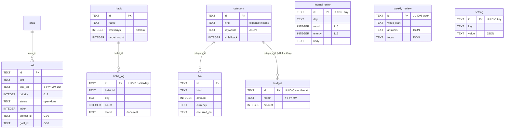

# Mô hình dữ liệu

Nguồn sự thật của schema là **`schema/*.sql`** (SQL thuần, dùng chung cho Swift và Android). Migration Swift `M0001_Initial` chạy đúng file `schema/0001_initial.sql`. Quy tắc: ADR-0003, ADR-0013, ADR-0014, ADR-0016 (ràng buộc của SyncEngine: cột `NOT NULL` có `ON CONFLICT REPLACE` + `DEFAULT`, không `UNIQUE`, chỉ thêm).

## 1. Sơ đồ quan hệ (MVP)

## 2. Bảng và quy tắc riêng

| Bảng | Đồng bộ | ID | Ghi chú nghiệp vụ |
|---|---|---|---|
| `area` | Có | v7 | Mẫu ban đầu: Công việc, Cá nhân, Sức khỏe, Nhà (BR-TSK-01) |
| `task` | Có | v7 | `inbox=1` khi tạo từ Ghi nhanh mà không có ngày (BR-CAP-04) |
| `habit` | Có | v7 | Lưu trữ = `archived_at`, không xoá lịch sử |
| `habit_log` | Có | **v5** `habit_log:<habit_id>:<day>` | Hai máy tick cùng ngày → một hàng (BR-HAB-03) |
| `journal_entry` | Có | **v5** `journal_entry:<day>` | Một mục mỗi ngày. MVP: `body` LWW như mọi trường; sau MVP: `keepBoth` (ADR-0012) |
| `category` | Có | v7 | Mỗi `kind` có đúng một `is_fallback=1` ("Khác") trong dữ liệu mẫu |
| `txn` | Có | v7 | `amount > 0`; dấu do `kind` |
| `budget` | Có | **v5** `budget:<month>:<category_id or "total">` | Tháng chưa có thì kế thừa tháng gần nhất (BR-SPD-05) |
| `weekly_review` | Có | **v5** `weekly_review:<week_start>` | |
| `setting` | Có | **v5** `setting:<key>` | Giá trị JSON, LWW cả giá trị |
| `local_setting` | **Không** | — | Nội bộ máy, không đăng ký với SyncEngine |

## 3. Đồng bộ và hợp nhất

**MVP (ADR-0016):** bảng đồng bộ được đăng ký với `SyncEngine` của SQLiteData, đúng một chỗ: `LifeOSData/Sources/CloudSync/SyncTables.swift`. Mỗi trường hợp nhất theo kiểu bản sửa sau cùng thắng; xem SyncEngine trong LOS-021. ID v5 cho khoá tự nhiên vẫn giữ nguyên tác dụng: hai máy tick cùng một thói quen trong cùng một ngày sẽ ghi vào cùng một bản ghi CloudKit. `updated_at` do repository tự ghi; nó không dùng để hợp nhất.

**Sau MVP (LOS-075):** chuyển sang HLC theo trường của SPEC-sync. `journal_entry.body` đổi sang chính sách `keepBoth`: migration thêm `body_sealed` và bảng `journal_conflict`. Danh sách chính sách nằm ở `TestVectors/merge/schema.json`.

## 4. Dữ liệu mẫu khi tạo kho mới

- Danh mục việc: Công việc, Cá nhân, Sức khỏe, Nhà.
- Danh mục chi: Ăn uống (`cafe, ca phe, pho, bun, com, an, tra sua`), Đi lại (`grab, xang, xe, taxi, gui xe`), Mua sắm (`shopee, lazada, quan ao`), Hoá đơn (`dien, nuoc, internet, wifi`), Sức khỏe (`thuoc, kham`), Giải trí (`phim, game`), Khác (fallback).
- Danh mục thu: Lương (`luong`), Thưởng (`thuong`), Khác (fallback).
- Từ khoá viết **không dấu**; so khớp sau khi bỏ dấu (SPEC-quick-capture §3).
- Dữ liệu mẫu tạo bằng ID **v5** `seed:<tên>` để hai máy cùng tạo kho mới không sinh hai bộ danh mục.

## 5. Dữ liệu seed để đo hiệu năng

`reference/seed.py` (LOS-022) sinh DB ~3 năm dùng thật: 6 thói quen × 1.095 ngày, ~4.000 việc, ~3.600 giao dịch, 1.000 mục nhật ký. Mọi đo hiệu năng (TC-PERF-*) chạy trên DB này, không chạy trên DB rỗng.
