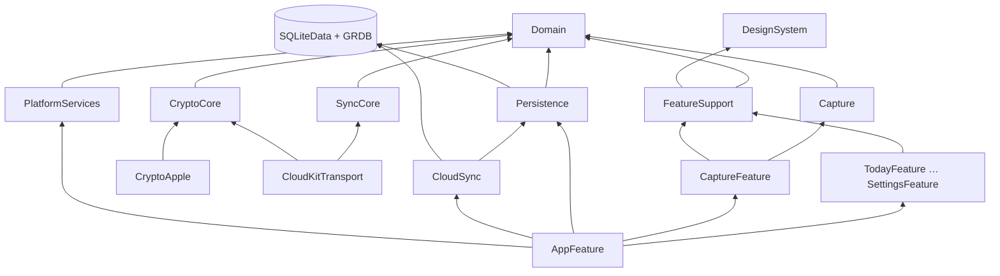

# Cấu trúc module, thư mục và quy tắc tạo file

Theo ADR-0007, ADR-0008, ADR-0016, ADR-0017. Đây là luật, không phải gợi ý: agent tạo file sai chỗ thì PR bị trả lại.

- Vì sao chia như vậy, và nguồn best practice của từng quy tắc: [overview.md](overview.md), [references.md](references.md).
- Từng bước cho mỗi loại thay đổi: [recipes.md](recipes.md). Thứ đã có: [inventory.md](inventory.md).
- Tạo file bằng `python3 scripts/new.py <loại> <Tên>`. Kiểm bằng `python3 -I scripts/check_structure.py` (chạy trong CI và lefthook). Danh sách thư mục được phép nằm trong bảng `ALLOWED` của script; muốn thêm thì sửa script và file này trong cùng PR, kèm ADR.

## 1. Cây thư mục đầy đủ

```
App/
  LifeOS.xcodeproj               Tạo bằng Xcode (LOS-003). Một target đa nền tảng iOS + macOS.
  LifeOS/
    LifeOSApp.swift              @main: tạo AppEnvironment.live(), gắn RootView. Không logic khác.
    Info.plist
    LifeOS.entitlements          iCloud (CloudKit, container iCloud.<bundle-id>), App Groups, Keychain sharing
    Assets.xcassets              Chỉ AppIcon và màu launch. Màu UI nằm trong DesignSystem.
    Localizable.xcstrings        Chuỗi của target app (ít). Chuỗi tính năng nằm trong từng gói.
  LifeOSWidgets/                 (sau MVP) extension widget, chỉ import DesignSystem + Persistence (đọc)

Packages/
  LifeOSCore/                    Swift thuần. `swift test` chạy trên Linux.
    Package.swift
    Sources/
      Domain/
        Model/                   Entity dạng struct: TaskItem, Habit, HabitLog, JournalEntry, Transaction, Category, Budget, WeeklyReview
        Values/                  LocalDate, LocalMonth, Money, Priority, Mood, Energy, EntityID
        Rules/                   Hàm thuần cho business rule: Streak, BudgetStatus, TodaySelection, OverdueRule
        Errors/                  DomainError
        Ports/                   Protocol cho mọi thứ bên ngoài: TaskRepository, TodayReading, AppClock, LogSink, ReminderScheduling (ADR-0017)
        ReadModels/              Snapshot đã định hình cho màn: TodaySnapshot, TaskGroupsSnapshot… (struct Sendable)
      Capture/                   QuickCaptureParser, AmountParser, DateTokenParser, VietnameseText (bỏ dấu)
      SyncCore/                  ── SAU MVP (ADR-0016, LOS-075): đồng bộ mã hoá tự làm ──
        Clock/                   HybridLogicalClock, HLCTimestamp
        Model/                   FieldChange, RowState, SyncTableSchema, MergePolicy
        Merge/                   Merger (thuần, có test vector)
        Transport/               SyncTransport (protocol), TransportEvent
        Coordinator/             SyncCoordinator (actor), SyncStatus
      CryptoCore/                ── SAU MVP ──
        CryptoProvider.swift     protocol: seal/open AEAD, hkdf, random
        Envelope/                EnvelopeCodec (LOS1)
        Keys/                    KeyVault, KeyBundle, KeyID, RecoveryCode (bảng 23 ký tự)
      TestSupport/               (chỉ dùng trong test và preview) VectorLoader
        Fakes/                   Bản giả cho mọi port: FakeTaskRepository, FixedClock… (chạy Linux)
        Fixtures/                Dữ liệu mẫu: Fixtures.tasks, Fixtures.today
    Tests/
      DomainTests/ CaptureTests/ SyncCoreTests/ CryptoCoreTests/
  LifeOSData/                    Chỉ Apple. SQLiteData + GRDB (ADR-0016).
    Sources/
      Persistence/
        Database/                AppDatabase (DatabasePool, WAL, attachMetadatabase), Pragmas
        Migrations/              M0001_Initial.swift chạy sql/0001_initial.sql; M0002_… (chỉ thêm)
        Tables/                  TaskRow, HabitRow… (`@Table` của SQLiteData), ánh xạ 2 chiều với entity Domain
        Repositories/            Adapter cài đặt port ghi: SQLiteTaskRepository: TaskRepository…
        Queries/                 Adapter cài đặt port đọc: TodayQuery: TodayReading… (trả snapshot của Domain)
      CloudSync/                 CloudSync.makeEngine, SyncTables, SyncStatusMonitor. NƠI DUY NHẤT nhắc SyncEngine.
    Tests/
      PersistenceTests/          DB tạm thật; CloudSyncTests/ (TC-SYNC-15, chạy trên macOS)
  LifeOSPlatform/                Chỉ Apple.
    Sources/
      CryptoApple/               (sau MVP) CryptoKitProvider: CryptoProvider; KeychainStore
      CloudKitTransport/         (sau MVP) CloudKitSyncTransport: SyncTransport (CKSyncEngine), RecordMapper
      PlatformServices/          NotificationScheduler, BackgroundTasks, AppLock (LocalAuthentication), Metrics (MetricKit), Haptics?
    Tests/
  LifeOSDesignSystem/            Đã có. Token sinh tự động + component.
  LifeOSFeatures/
    Sources/
      FeatureSupport/            StoreLifecycle, FormatterCache, UndoCoordinator, ScreenState, AppEnvironment (protocol phần)
      AppFeature/                RootView, AppTab, Router, AppEnvironment.live() ghép mọi cài đặt
      TodayFeature/ TasksFeature/ HabitsFeature/ JournalFeature/ SpendingFeature/
      ReviewFeature/ CaptureFeature/ OnboardingFeature/ SettingsFeature/
    Tests/
      <Feature>Tests/            Test store bằng bản giả từ TestSupport/Fakes

design/        tokens/, reference/ (HTML Screens, Library), HANDOFF.md
docs/          xem docs/README.md
TestVectors/   hlc/, merge/, quick-capture/, recovery-code/, envelope/  (JSON)
reference/     Code tham chiếu Python sinh và kiểm test vector
scripts/       new.py (tạo file theo mẫu), check_structure.py, inventory.py, bootstrap_github.py, plan_graph.py, check-core-imports.sh, check-mermaid.mjs
```

## 2. Đồ thị phụ thuộc giữa target



Feature **không** import `Persistence`: protocol repository nằm ở `Domain/Ports`, snapshot ở `Domain/ReadModels` (ADR-0017; phụ thuộc vào interface, không vào cài đặt [S-TMA] [S-CLEAN]). Không dùng `@FetchAll`/`@FetchOne` trong View (ADR-0016 ranh giới 3). Chỉ `AppFeature` import `Persistence`, tạo cài đặt cụ thể và gọi `CloudSync` [S-ROOT]. `CryptoApple`, `CloudKitTransport`, `SyncCore`, `CryptoCore` chưa được nối trong MVP (LOS-075).

## 3. Bên trong một Feature target

```
TasksFeature/
  TasksScreen.swift          View gốc của màn (đặt tên <Name>Screen). Chỉ bố cục, gọi store.
  TasksStore.swift           @Observable @MainActor final class. Trạng thái + hành động.
  TasksSnapshot.swift        (chỉ khi cần trạng thái dẫn xuất riêng; dữ liệu DB dùng snapshot của Domain/ReadModels)
  Components/
    TaskRowView.swift        View con; nhận struct giá trị, closure hành động.
    AddTaskSheet.swift
  Strings/
    Localizable.xcstrings    Chuỗi của tính năng (tiếng Việt là ngôn ngữ gốc)
  Previews/
    TasksScreen+Previews.swift  #Preview với dữ liệu mẫu, Light/Dark, chữ AX5
```

Gốc Feature chỉ chứa `<Name>Screen`, `<Name>Store`, `<Name>Snapshot` (và file `<X>Feature.swift` giữ chỗ). Mọi view khác vào `Components/`.

## 4. Quy tắc tạo file

| Bạn cần | Đặt ở | Tên file / type | Bắt buộc kèm |
|---|---|---|---|
| Entity mới | `Domain/Model/` | `<Thing>.swift`, `struct <Thing>: Sendable, Hashable, Identifiable` | Cập nhật data-model.md |
| Quy tắc nghiệp vụ | `Domain/Rules/` | `<Rule>.swift`, hàm `static` thuần | Test có `BR-xxx` trong tên/comment |
| Bảng mới / cột mới | `schema/` + `LifeOSData/…/Persistence/Migrations/` | `M<NNNN>_<Mô tả>.swift` + `NNNN_<mô tả>.sql` | Theo luật SyncEngine (header schema), thêm vào `SyncTables` nếu đồng bộ, test migration từ DB phiên bản trước |
| Bảng `@Table` | `Persistence/Tables/` | `<Thing>Row.swift` | Ánh xạ 2 chiều với entity |
| Truy vấn cho màn | `Domain/ReadModels/` + `Domain/Ports/` + `Persistence/Queries/` | `<X>Snapshot`, `protocol <X>Reading`, `<X>Query` | Index nếu lọc/sắp xếp; test với DB seed (R5) |
| Repository | `Domain/Ports/` + `TestSupport/Fakes/` + `Persistence/Repositories/` | `protocol <Thing>Repository`, `Fake<Thing>Repository`, `SQLite<Thing>Repository` | Ghi `updated_at`; xoá = đặt `deleted_at` (R4) |
| Màn mới | `LifeOSFeatures/Sources/<X>Feature/` | `<Name>Screen`, `<Name>Store` | Preview, chuỗi trong xcstrings, test store, spec màn trong `docs/design/screens/` |
| Component dùng chung | `LifeOSDesignSystem/.../Components/` | `<Name>.swift` | Thêm vào `Catalog.swift`, nhãn VoiceOver |
| Adapter Apple | `LifeOSPlatform/Sources/<Module>/` | `<Tech><Protocol>` (vd. `UserNotificationReminderScheduler`) | Port ở `Domain/Ports` và bản giả ở `TestSupport/Fakes` trước (R8) |
| Đổi gì về đồng bộ | `LifeOSData/Sources/CloudSync/` | — | Không chỗ nào khác được nhắc SyncEngine (TC-SYNC-14) |
| Thay đổi định dạng trên dây | `docs/specs/` trước | — | Tăng version spec, test vector mới, code tham chiếu Python |
| Quyết định kiến trúc | `docs/architecture/adr/` | `NNNN-<slug>.md` | Cập nhật bảng ADR README |

Không được: tạo file `Utils.swift`, `Helpers.swift`, `Extensions.swift` chung chung (đặt extension cạnh type nó phục vụ, tên `<Type>+<Mục đích>.swift`); thêm target hoặc gói SPM mới mà không có ADR; đặt hai type public lớn trong một file.

## 5. Mẫu khung một Store

```swift
import Observation
import Domain          // port + snapshot; KHÔNG import Persistence (ADR-0017)

@Observable @MainActor
public final class TasksStore {
    public private(set) var snapshot: TasksSnapshot = .empty   // chỉ giá trị, Sendable
    public private(set) var undo: UndoToken?

    private let tasks: any TaskRepository
    private let clock: any AppClock
    @ObservationIgnored private var observation: Task<Void, Never>?

    public init(tasks: any TaskRepository, clock: any AppClock) {
        self.tasks = tasks
        self.clock = clock
    }

    public func start() {                     // gọi từ .task { } của Screen
        observation = Task { [tasks] in
            for await next in tasks.observeToday(clock.today) { self.snapshot = next }
        }
    }

    public func toggle(_ id: TaskItem.ID) async {
        // BR-TSK-03: tick xong thì hiện Hoàn tác 4 giây
        do { undo = try await tasks.toggle(id, at: clock.now) } catch { /* ScreenState.error, không crash */ }
    }
}
```
