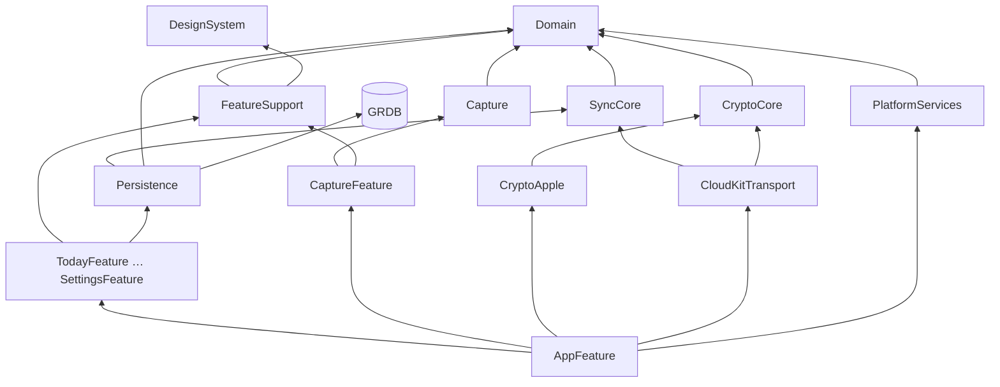

# Cấu trúc module, thư mục và quy tắc tạo file

Theo ADR-0007, ADR-0008. Đây là luật, không phải gợi ý: agent tạo file sai chỗ thì PR bị trả lại.

## 1. Cây thư mục đầy đủ

```
App/
  LifeOS.xcodeproj               Tạo bằng Xcode (LOS-003). Một target đa nền tảng iOS + macOS.
  LifeOS/
    LifeOSApp.swift              @main: tạo AppEnvironment.live(), gắn RootView. Không logic khác.
    Info.plist
    LifeOS.entitlements          iCloud (CloudKit, container iCloud.<bundle-id>), App Groups, Keychain sharing
    Assets.xcassets              Chỉ AppIcon và màu launch. Màu UI nằm trong DesignSystem.
    Localizable.xcstrings        Chuỗi của target app (ít). Chuỗi tính năng nằm trong từng gói.
  LifeOSWidgets/                 (sau MVP) extension widget, chỉ import DesignSystem + Persistence (đọc)

Packages/
  LifeOSCore/                    Swift thuần. `swift test` chạy trên Linux.
    Package.swift
    Sources/
      Domain/
        Model/                   Entity dạng struct: TaskItem, Habit, HabitLog, JournalEntry, Transaction, Category, Budget, WeeklyReview
        Values/                  LocalDate, LocalMonth, Money, Priority, Mood, Energy, EntityID
        Rules/                   Hàm thuần cho business rule: Streak, BudgetStatus, TodaySelection, OverdueRule
        Errors/                  DomainError
      Capture/                   QuickCaptureParser, AmountParser, DateTokenParser, VietnameseText (bỏ dấu)
      SyncCore/
        Clock/                   HybridLogicalClock, HLCTimestamp
        Model/                   FieldChange, RowState, SyncTableSchema, MergePolicy
        Merge/                   Merger (thuần, có test vector)
        Transport/               SyncTransport (protocol), TransportEvent
        Coordinator/             SyncCoordinator (actor), SyncStatus
      CryptoCore/
        CryptoProvider.swift     protocol: seal/open AEAD, hkdf, random
        Envelope/                EnvelopeCodec (LOS1)
        Keys/                    KeyVault, KeyBundle, KeyID, RecoveryCode (bảng 23 ký tự)
      Persistence/
        Database/                DatabaseFactory, AppDatabase (DatabasePool), Pragmas
        Migrations/              M0001_Initial.swift, M0002_….swift (chỉ thêm)
        Records/                 TaskRecord, HabitRecord… (GRDB FetchableRecord/PersistableRecord)
        Repositories/            protocol + GRDB impl: TaskRepository, HabitRepository…
        Queries/                 TodayQuery, UpcomingTasksQuery, MonthSpendingQuery… (trả snapshot)
        Sync/                    SyncWriter, OutboxStore, FieldClockStore, SyncSchemaRegistry
      TestSupport/               (chỉ dùng trong test) FixedClock, InMemoryDatabase, FakeTransport, VectorLoader, Fixtures
    Tests/
      DomainTests/ CaptureTests/ SyncCoreTests/ CryptoCoreTests/ PersistenceTests/
  LifeOSPlatform/                Chỉ Apple.
    Sources/
      CryptoApple/               CryptoKitProvider: CryptoProvider; KeychainStore
      CloudKitTransport/         CloudKitSyncTransport: SyncTransport (CKSyncEngine), RecordMapper
      PlatformServices/          NotificationScheduler, BackgroundTasks, AppLock (LocalAuthentication), Metrics (MetricKit), Haptics?
    Tests/
  LifeOSDesignSystem/            Đã có. Token sinh tự động + component.
  LifeOSFeatures/
    Sources/
      FeatureSupport/            StoreLifecycle, FormatterCache, UndoCoordinator, ScreenState, AppEnvironment (protocol phần)
      AppFeature/                RootView, AppTab, Router, AppEnvironment.live() ghép mọi cài đặt
      TodayFeature/ TasksFeature/ HabitsFeature/ JournalFeature/ SpendingFeature/
      ReviewFeature/ CaptureFeature/ OnboardingFeature/ SettingsFeature/
    Tests/
      <Feature>Tests/            Test store bằng repository giả

design/        tokens/, reference/ (HTML Screens, Library), HANDOFF.md
docs/          xem docs/README.md
TestVectors/   hlc/, merge/, quick-capture/, recovery-code/, envelope/  (JSON)
reference/     Code tham chiếu Python sinh và kiểm test vector
scripts/       bootstrap_github.py, plan_graph.py, check-core-imports.sh, check-mermaid.mjs
```

## 2. Đồ thị phụ thuộc giữa target



Feature được import `Persistence` để lấy **protocol repository và kiểu snapshot**, không được tạo `DatabasePool`. Chỉ `AppFeature` tạo cài đặt cụ thể.

## 3. Bên trong một Feature target

```
TasksFeature/
  TasksScreen.swift          View gốc của màn (đặt tên <Name>Screen). Chỉ bố cục, gọi store.
  TasksStore.swift           @Observable @MainActor final class. Trạng thái + hành động.
  TasksSnapshot.swift        (nếu không dùng thẳng snapshot từ Persistence/Queries)
  Components/
    TaskRowView.swift        View con; nhận struct giá trị, closure hành động.
    AddTaskSheet.swift
  Strings/
    Localizable.xcstrings    Chuỗi của tính năng (tiếng Việt là ngôn ngữ gốc)
  Previews/
    TasksScreen+Previews.swift  #Preview với dữ liệu mẫu, Light/Dark, chữ AX5
```

## 4. Quy tắc tạo file

| Bạn cần | Đặt ở | Tên file / type | Bắt buộc kèm |
|---|---|---|---|
| Entity mới | `Domain/Model/` | `<Thing>.swift`, `struct <Thing>: Sendable, Hashable, Identifiable` | Cập nhật data-model.md |
| Quy tắc nghiệp vụ | `Domain/Rules/` | `<Rule>.swift`, hàm `static` thuần | Test có `BR-xxx` trong tên/comment |
| Bảng mới / cột mới | `Persistence/Migrations/` | `M<NNNN>_<Mô tả>.swift` | Đăng ký trong `SyncSchemaRegistry`, test migration từ DB phiên bản trước |
| Record GRDB | `Persistence/Records/` | `<Thing>Record.swift` | Ánh xạ 2 chiều với entity |
| Truy vấn cho màn | `Persistence/Queries/` | `<Screen><Thing>Query.swift` trả `<…>Snapshot` | Index nếu lọc/sắp xếp; test với DB seed |
| Repository | `Persistence/Repositories/` | `protocol <Thing>Repository` + `GRDB<Thing>Repository` | Mọi ghi qua `SyncWriter` |
| Màn mới | `LifeOSFeatures/Sources/<X>Feature/` | `<Name>Screen`, `<Name>Store` | Preview, chuỗi trong xcstrings, test store, spec màn trong `docs/design/screens/` |
| Component dùng chung | `LifeOSDesignSystem/.../Components/` | `<Name>.swift` | Thêm vào `Catalog.swift`, nhãn VoiceOver |
| Adapter Apple | `LifeOSPlatform/Sources/<Module>/` | `<Tech><Protocol>` (vd. `CloudKitSyncTransport`) | Protocol phải nằm ở Core trước |
| Thay đổi định dạng trên dây | `docs/specs/` trước | — | Tăng version spec, test vector mới, code tham chiếu Python |
| Quyết định kiến trúc | `docs/architecture/adr/` | `NNNN-<slug>.md` | Cập nhật bảng ADR README |

Không được: tạo file `Utils.swift`, `Helpers.swift`, `Extensions.swift` chung chung (đặt extension cạnh type nó phục vụ, tên `<Type>+<Mục đích>.swift`); thêm target hoặc gói SPM mới mà không có ADR; đặt hai type public lớn trong một file.

## 5. Mẫu khung một Store

```swift
import Observation
import Domain
import Persistence

@Observable @MainActor
public final class TasksStore {
    public private(set) var snapshot: TasksSnapshot = .empty   // chỉ giá trị, Sendable
    public private(set) var undo: UndoToken?

    private let tasks: any TaskRepository
    private let clock: any AppClock
    @ObservationIgnored private var observation: Task<Void, Never>?

    public init(tasks: any TaskRepository, clock: any AppClock) {
        self.tasks = tasks
        self.clock = clock
    }

    public func start() {                     // gọi từ .task { } của Screen
        observation = Task { [tasks] in
            for await next in tasks.observeToday(clock.today) { self.snapshot = next }
        }
    }

    public func toggle(_ id: TaskItem.ID) async {
        // BR-TSK-03: tick xong thì hiện Hoàn tác 4 giây
        do { undo = try await tasks.toggle(id, at: clock.now) } catch { /* ScreenState.error, không crash */ }
    }
}
```
