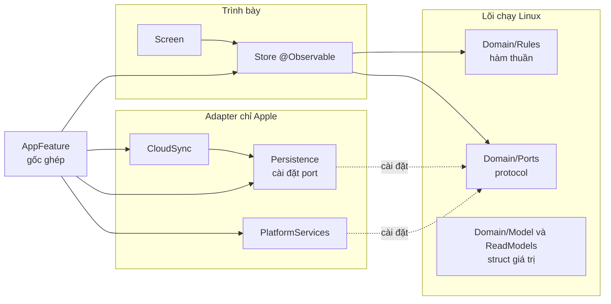

# Kiến trúc tổng quan: đọc trước khi viết code

Một trang để agent và người mới nắm ba điều: kiến trúc dựa trên mẫu nào, mỗi thứ đặt ở đâu, và khi nào dùng gì. Mỗi quy tắc ghi mã nguồn `[S-…]` trỏ tới [references.md](references.md); `[Dự án]` là lựa chọn riêng, có lý do trong ADR.

Chi tiết nằm ở:
- [module-structure.md](module-structure.md): cây thư mục, bảng quy tắc tạo file.
- [recipes.md](recipes.md): từng bước cho mỗi loại thay đổi.
- [inventory.md](inventory.md): danh mục thứ đã có, tự sinh.
- [system-design.md](system-design.md): luồng chạy.

## 1. Bốn mẫu đã được dùng rộng rãi (ADR-0017)

| Câu hỏi | Mẫu | Ở Life OS | Nguồn |
|---|---|---|---|
| Lớp nào phụ thuộc lớp nào? | **Ports & Adapters**, dependency rule của **Clean Architecture** | `Domain` ở giữa, không phụ thuộc ai. Adapter (`Persistence`, `CloudSync`, `PlatformServices`) cài đặt port của Domain | [S-HEX] [S-CLEAN] |
| Chia code thành module ra sao? | **Module theo tính năng** trên Swift package cục bộ | Một target cho mỗi tính năng; tính năng không biết nhau, chỉ biết port | [S-TMA] [S-ISO] [S-APPLE-PKG] |
| UI giữ trạng thái thế nào? | **Model `@Observable`** do View sở hữu bằng `@State`, dữ liệu một chiều | `<X>Store` là model `@Observable`; Screen giữ nó bằng `@State private var store` | [S-OBS] [S-MODEL] |
| Ai tạo đối tượng thật? | **Composition Root** | Chỉ `AppFeature` (`AppEnvironment.live()`), gọi từ `@main` | [S-ROOT] [S-SQLD] |



Chỗ Life OS khác mẫu gốc, và lý do, ghi ở [references.md § Quy tắc riêng](references.md#quy-tắc-riêng-của-dự-án-dự-án): không có lớp UseCase; port gom trong `Domain` thay vì mỗi tính năng một target Interface.

## 2. Một thao tác chạy qua đâu

**Đọc:** repository hoặc query theo dõi DB bằng `ValueObservation` (qua SQLiteData) [S-GRDB-CONC], trả `…Snapshot` là struct giá trị [S-CLEAN: không đưa dòng DB qua ranh giới] → `Store.snapshot` → `Screen` vẽ.

**Ghi:** `Screen` gọi `Store.action()` → Store áp `Domain/Rules` → gọi port (`repository.save…`) trong một transaction [S-GRDB-CONC] → luồng đọc tự đẩy snapshot mới. Store **không** tự sửa snapshot sau khi ghi, để mỗi dữ liệu chỉ có một nguồn sự thật [S-MODEL]. Muốn phản hồi tức thì thì dùng cập nhật lạc quan như system-design §5.

## 3. Khi nào dùng gì

| Bạn cần… | Dùng | Không dùng | Nguồn |
|---|---|---|---|
| Dữ liệu nghiệp vụ (việc, giao dịch) | `struct` trong `Domain/Model`, `Sendable, Hashable` | class, NSObject | [S-GRDB-REC] record là struct; [S-CLEAN] entity độc lập framework |
| Kiểu giá trị có luật (ngày, tiền, ID) | `Domain/Values` (`LocalDate`, `Money`, `EntityID<T>`) | `String`, `Double`, `Date` trần | [Dự án] ADR-0013, ADR-0014 |
| Tính toán nghiệp vụ (chuỗi ngày, vượt ngân sách) | Hàm `static` thuần trong `Domain/Rules`, có test `BR-…` | Code trong Store hay View | [S-CLEAN] luật test được không cần UI, DB; [Dự án] không lớp UseCase |
| Dữ liệu đã định hình cho một màn | `…Snapshot` trong `Domain/ReadModels`, do Query trả về | Store tự gộp từ nhiều repository; trả thẳng `@Table` row | [S-CLEAN] cấu trúc đơn giản qua ranh giới |
| Truy cập dữ liệu | Port trong `Domain/Ports` + `SQLite…` trong `Persistence` | SQL trong Store, `@FetchAll` trong View | [S-HEX] [S-CLEAN] đảo phụ thuộc; [S-TMA] phụ thuộc interface |
| Một bảng mới | Một `@Table` struct cho một bảng, cột khớp tên | Struct gộp nhiều bảng | [S-GRDB-REC] |
| Mở DB | Đúng một `DatabasePool` tạo trong `AppDatabase`, ghép ở AppFeature | Mở DB trong Feature hay test chung một file | [S-GRDB-CONC] [S-ROOT] |
| Đổi schema | Migration mới bằng chuỗi SQL, không sửa migration đã phát hành | Sửa `0001_initial.sql` sau khi phát hành; dựng schema từ type Swift | [S-GRDB-MIG] |
| Trạng thái của màn (đang sửa, sheet mở) | Thuộc tính trong Store `@Observable` | `@State` cho thứ cần test | [S-OBS] |
| Trạng thái thuần trình bày (hover, focus, cuộn) | `@State`, `@FocusState` private trong View | Store | [S-MODEL] trạng thái UI tạm thời |
| Screen giữ Store | `@State private var store` | `@StateObject`, `ObservableObject`, `@Published` | [S-OBS] |
| View con cần sửa thuộc tính Store | `@Bindable` | Truyền closure cho từng trường | [S-OBS] |
| Hàng trong danh sách | Nhận đúng struct của hàng đó, có `id` ổn định | Nhận cả Store hay cả mảng | [S-PERF23] [S-PERF25] |
| Danh sách dài | Stack thường trước; `LazyVStack`/`List` khi đo trên máy thật thấy lợi | Lazy mặc định mọi nơi; đo trên simulator | [S-LAZY] |
| Định dạng ngày, tiền trong View | `FormatterCache` hoặc chuỗi đã định dạng trong snapshot | Tạo formatter trong `body` | [S-PERF25] |
| View rẽ nhánh nhiều kiểu | `@ViewBuilder`, `if` cân đối | `AnyView` | [S-PERF23] |
| Dịch vụ hệ thống (thông báo, Face ID) | Port trong Domain + adapter trong `PlatformServices` | Gọi API Apple thẳng trong Feature | [S-HEX] mỗi thiết bị ngoài một adapter |
| Bản giả để test và preview | `Fake<Port>` trong `TestSupport` | Mock viết lại trong từng file test | [S-TMA] target Testing; [S-HEX] mock DB trong bộ nhớ |
| Thứ dùng chung giữa các màn (formatter, undo, trạng thái lỗi) | `FeatureSupport` | Copy sang từng Feature | [Dự án] một nguồn |
| UI dùng lại ở ≥ 2 màn hoặc có trong design | Component ở `LifeOSDesignSystem/Components` | View trong Feature | [Dự án] ADR-0009 |
| UI chỉ một màn dùng | `<X>Feature/Components/<Thing>View.swift` | DesignSystem | [Dự án] tránh phình gói chung |
| Màu, khoảng cách, chữ, bo góc | Token (`LifeOSColor`, `Space`, `.lifeOSText`) | Số và màu cứng | [Dự án] ADR-0009 |
| Việc nền có trạng thái dùng chung | `actor` | class có lock, `DispatchQueue` | [S-CONC] (chưa trích, xem references) |
| Việc bất đồng bộ của màn | `Task` giữ trong Store, huỷ khi rời màn; hoặc `.task {}` | `Task.detached`, Combine | [S-CONC] (chưa trích) |
| Lỗi người dùng phải thấy | `ScreenState.error(UserFacingError)` (BR-GEN-08) | `alert` tự do | [Dự án] |
| Hằng cấu hình | `static let` trong type sở hữu nó, hoặc `enum` không case làm namespace | File `Constants.swift` chung, biến toàn cục | [S-AIRBNB] |
| Mở rộng type có sẵn | `<Type>+<Mục đích>.swift` cạnh nơi dùng | `Extensions.swift` | [S-GOOG] |
| Đặt tên protocol | Danh từ (`TaskRepository`) hoặc `-ing/-able` (`TodayReading`) | `ITaskRepository`, `TaskRepositoryProtocol` | [S-API] |
| Test | Swift Testing `@Test`, `#expect`, tham số hoá; không chia sẻ trạng thái | XCTest cho test mới | [S-TEST] |

## 4. Tìm trước khi viết (bắt buộc với agent)

Trước khi tạo type, hàm hoặc component mới:
1. Mở [inventory.md](inventory.md). Nó liệt kê mọi type công khai theo target, kèm câu mô tả đầu của comment `///` [S-API: comment mở bằng câu tóm tắt]. File do `python3 scripts/inventory.py` sinh, CI kiểm nó luôn mới.
2. Tìm theo tên và theo ý nghĩa:
   ```sh
   rg -n "struct .*Money|func .*format" Packages
   rg -n "BR-HAB-04" Packages docs
   ```
3. Xem README của DesignSystem (bảng ánh xạ component) trước khi vẽ UI.
4. Đã có thứ gần giống thì **mở rộng** nó (thêm tham số, thêm case) thay vì viết bản thứ hai. Thật sự cần bản mới thì ghi lý do trong PR.
5. Tạo file bằng `python3 scripts/new.py <loại> <Tên>`. Script đặt file đúng chỗ, đúng tên [S-GOOG], kèm test, và in việc còn phải làm theo [recipes.md](recipes.md).
6. Chạy `python3 -I scripts/check_structure.py` trước khi commit (lefthook tự chạy).
