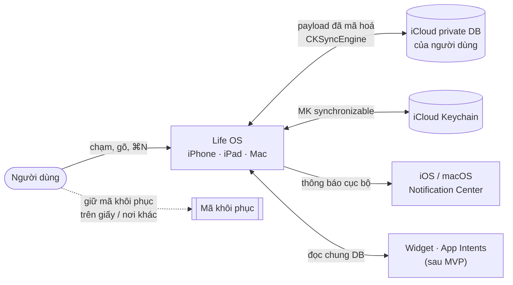
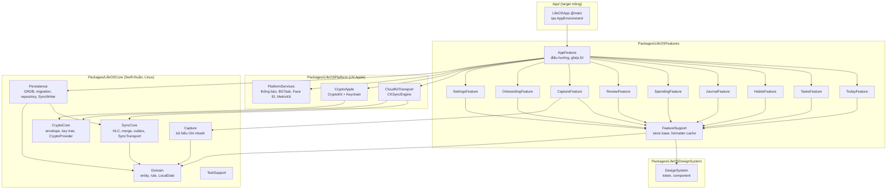
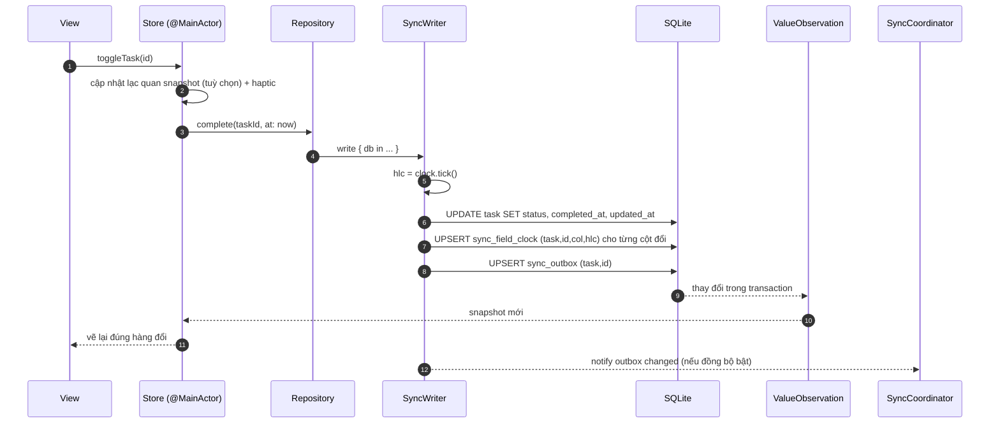
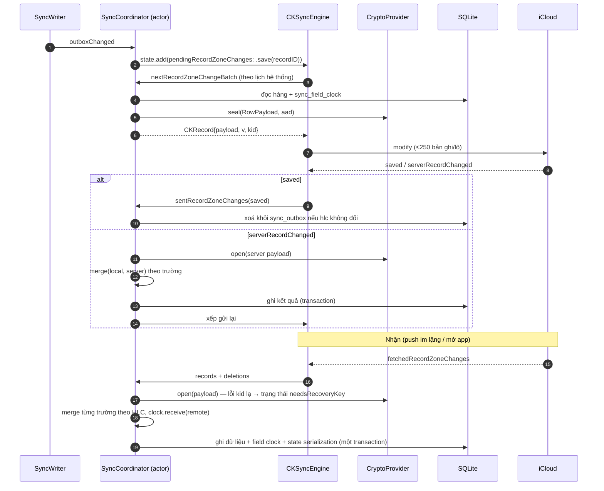
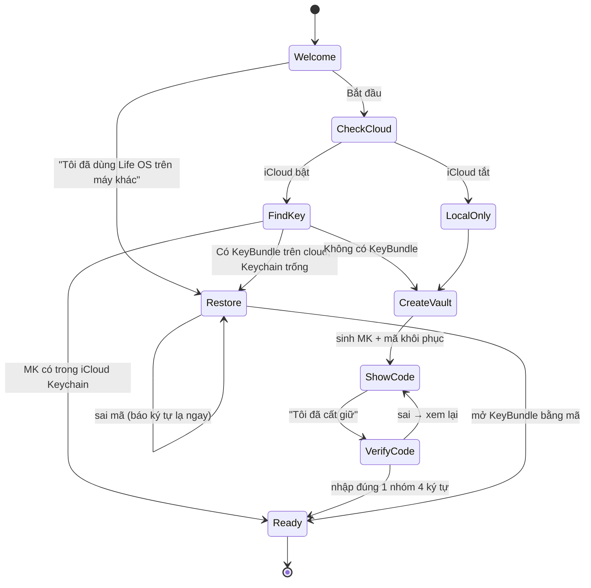

# System design: đồng bộ mã hoá tự làm (sau MVP)

Bản thiết kế gốc ngày 01/11/2026, trước ADR-0016. Áp dụng khi làm LOS-075: thay `CloudSync` (SQLiteData SyncEngine) bằng lớp tự làm theo SPEC-sync và SPEC-crypto. Đọc cùng `system-design.md`.

## P1. Bối cảnh (C4 mức 1)

Không có máy chủ Life OS. iCloud chỉ thấy ciphertext + vài trường kỹ thuật (`v`, `kid`, recordName ngẫu nhiên).

## P2. Container và lớp (C4 mức 2)

Quy tắc mũi tên (bị kiểm bằng build + `scripts/check-core-imports.sh`):
- `LifeOSCore` không import `SwiftUI`, `UIKit`, `AppKit`, `CloudKit`, `CryptoKit`, `Security`, `os`, `Combine`, `WidgetKit`. Chỉ `Foundation` (bản swift-corelibs) và `GRDB` (chỉ trong `Persistence`).
- Feature không import feature khác. Feature không import `LifeOSPlatform` (chỉ thấy protocol trong Core/FeatureSupport).
- Chỉ `AppFeature` biết cài đặt cụ thể (ghép DI).

## P5. Luồng: ghi một thay đổi (mọi tính năng)

Bất biến: **một thay đổi người dùng = một transaction** gồm dữ liệu + đồng hồ trường + outbox. Không có đường ghi nào vòng qua `SyncWriter` cho bảng đồng bộ. Kiểm: TC-SYNC-01..03.

## P7. Luồng: đồng bộ (gửi và nhận)

Điểm lỗi và cách xử lý: SPEC-sync §8. Kiểm: TC-SYNC-*, harness LOS-033.

## P8. Luồng: lần đầu dùng và máy mới

Chi tiết và chặn "hai MK": SPEC-crypto §6. Kiểm: TC-ONB-*.

