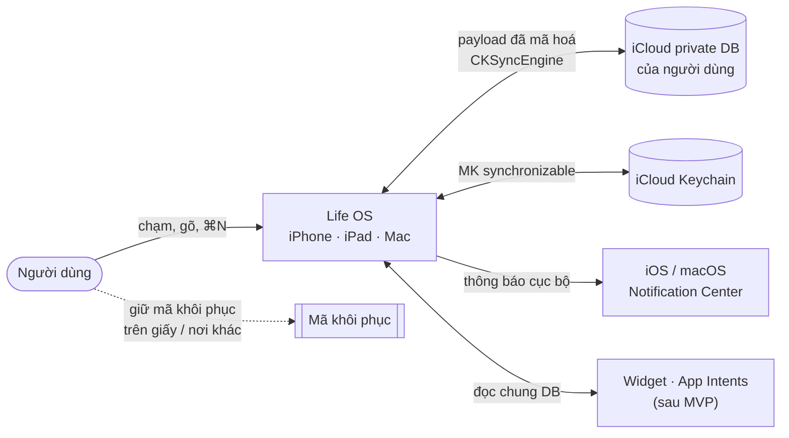
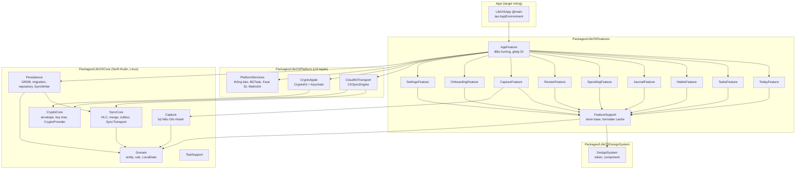
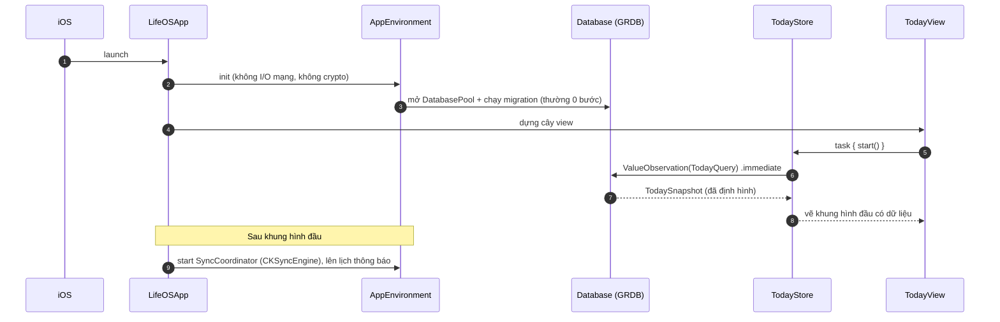
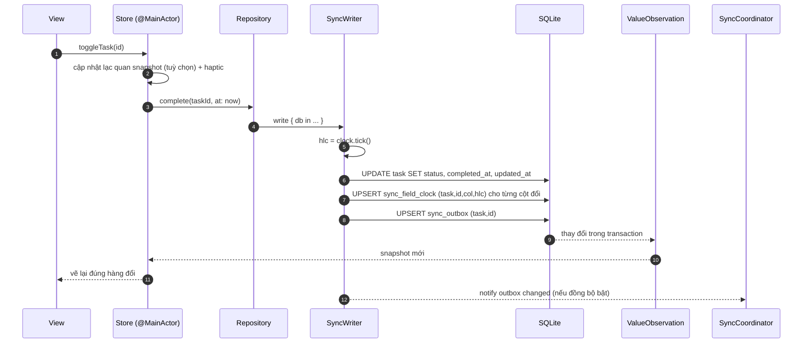
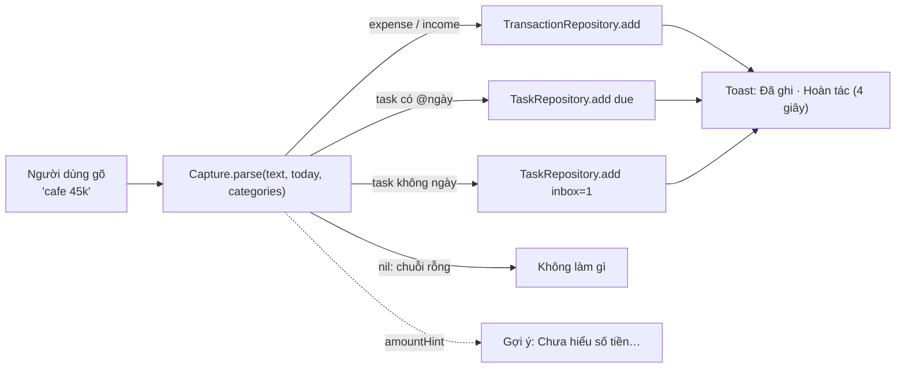
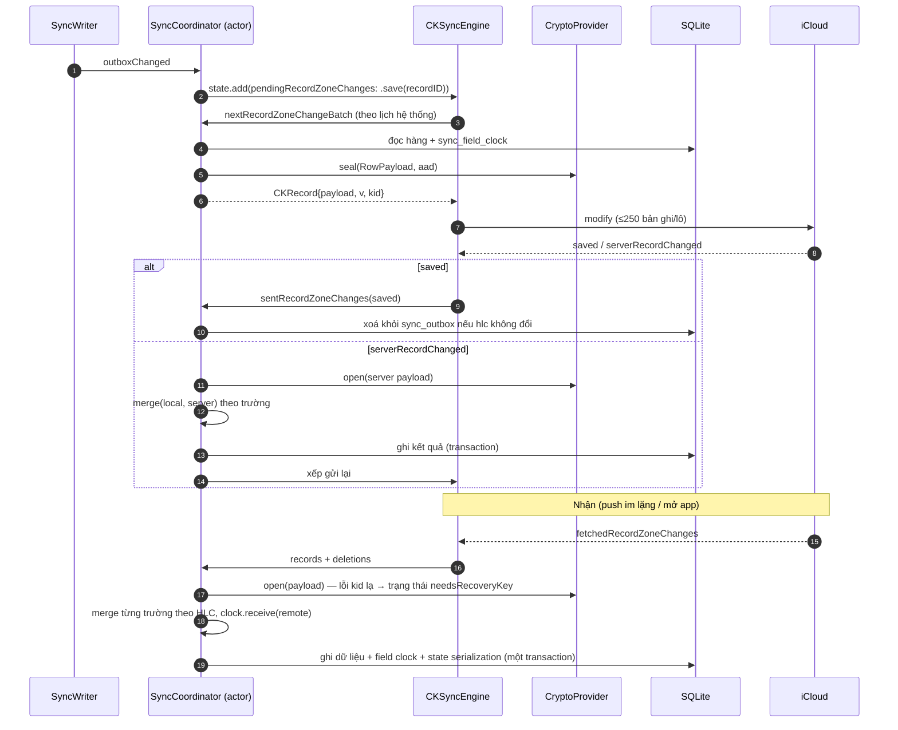
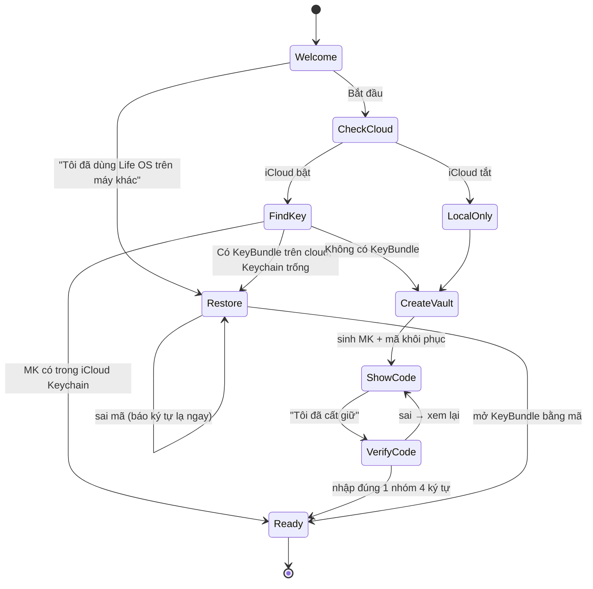
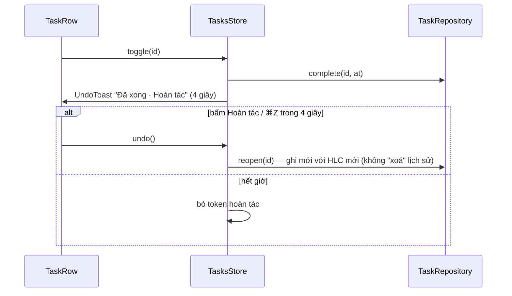
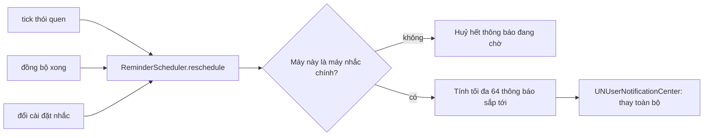

# System design

Tài liệu này mô tả hệ thống bằng sơ đồ (Mermaid, GitHub hiển thị trực tiếp). Mỗi luồng có: sơ đồ, quy tắc thread/actor, điểm lỗi, và test case kiểm nó. **Code một luồng = đi đúng các bước trong sơ đồ, đúng tên thành phần.** Đổi luồng thì sửa sơ đồ trong cùng PR.

## 1. Bối cảnh (C4 mức 1)

Không có máy chủ Life OS. iCloud chỉ thấy ciphertext + vài trường kỹ thuật (`v`, `kid`, recordName ngẫu nhiên).

## 2. Container và lớp (C4 mức 2)

Quy tắc mũi tên (bị kiểm bằng build + `scripts/check-core-imports.sh`):
- `LifeOSCore` không import `SwiftUI`, `UIKit`, `AppKit`, `CloudKit`, `CryptoKit`, `Security`, `os`, `Combine`, `WidgetKit`. Chỉ `Foundation` (bản swift-corelibs) và `GRDB` (chỉ trong `Persistence`).
- Feature không import feature khác. Feature không import `LifeOSPlatform` (chỉ thấy protocol trong Core/FeatureSupport).
- Chỉ `AppFeature` biết cài đặt cụ thể (ghép DI).

## 3. Mô hình chạy (thread & actor)

| Thành phần | Chạy ở đâu | Ghi chú |
|---|---|---|
| View, Store | `@MainActor` | Store chỉ giữ snapshot giá trị; không I/O |
| Repository, `SyncWriter` | `DatabasePool` của GRDB (hàng đợi riêng) | `async` API; ghi luôn trong `write { }` |
| `ValueObservation` | Đọc trên pool, giao kết quả `.immediate` lần đầu rồi về main | Lần đầu đồng bộ để không nháy "đang tải" |
| `SyncCoordinator` | `actor` riêng | Nhận sự kiện CKSyncEngine, gọi merge, ghi DB |
| Crypto | Gọi trong `SyncCoordinator` / repository, ngoài main | Giải mã nhật ký khi mở bài, không giải mã cả danh sách |
| Định dạng số/ngày | `FormatterCache` tạo một lần | Không tạo formatter trong `body` |

## 4. Luồng: khởi động lạnh tới màn Hôm nay (mục tiêu ≤ 400 ms)

Điểm lỗi: migration lỗi → màn "File dữ liệu trong máy hỏng" (BR-GEN-05), không crash. Kiểm: TC-PERF-01, TC-GEN-03.

## 5. Luồng: ghi một thay đổi (mọi tính năng)

Bất biến: **một thay đổi người dùng = một transaction** gồm dữ liệu + đồng hồ trường + outbox. Không có đường ghi nào vòng qua `SyncWriter` cho bảng đồng bộ. Kiểm: TC-SYNC-01..03.

## 6. Luồng: Ghi nhanh

Bộ hiểu là hàm thuần trong `Capture` (SPEC-quick-capture), có test vector. Xem trước kết quả cập nhật theo từng phím gõ, nên phải < 1 ms với chuỗi 200 ký tự. Kiểm: TC-CAP-*.

## 7. Luồng: đồng bộ (gửi và nhận)

Điểm lỗi và cách xử lý: SPEC-sync §8. Kiểm: TC-SYNC-*, harness LOS-033.

## 8. Luồng: lần đầu dùng và máy mới

Chi tiết và chặn "hai MK": SPEC-crypto §6. Kiểm: TC-ONB-*.

## 9. Luồng: tick việc và hoàn tác

Hoàn tác là một thay đổi mới, không phải rollback, để hội tụ đúng khi máy khác đã nhận thay đổi trước. Kiểm: TC-TSK-04.

## 10. Luồng: nhắc nhở cục bộ (sau MVP)

## 11. Ánh xạ luồng → code

| Luồng | Thành phần chính | Target |
|---|---|---|
| Khởi động | `LifeOSApp`, `AppEnvironment.live()`, `DatabaseFactory`, `TodayStore` | App, AppFeature, Persistence, TodayFeature |
| Ghi thay đổi | `SyncWriter`, `HybridLogicalClock`, `*Repository` | Persistence, SyncCore |
| Ghi nhanh | `QuickCaptureParser`, `CaptureStore` | Capture, CaptureFeature |
| Đồng bộ | `SyncCoordinator`, `SyncTransport`, `CloudKitSyncTransport`, `RowPayloadCodec`, `Merger` | SyncCore, CloudKitTransport |
| Khoá | `KeyVault`, `RecoveryCode`, `EnvelopeCodec`, `CryptoKitProvider`, `KeychainStore` | CryptoCore, CryptoApple |
| Hoàn tác | `UndoCoordinator` (FeatureSupport), `UndoToast` | FeatureSupport, DesignSystem |
