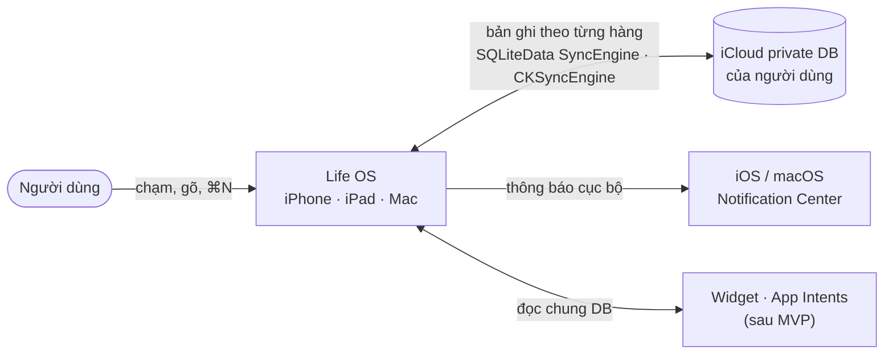
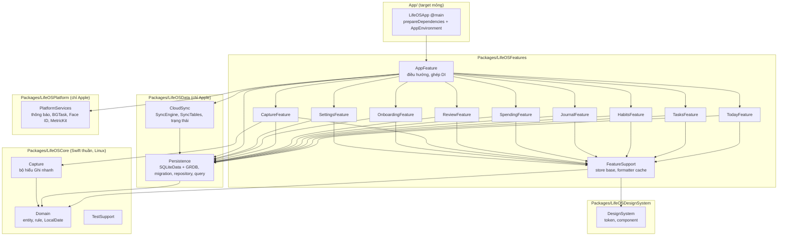
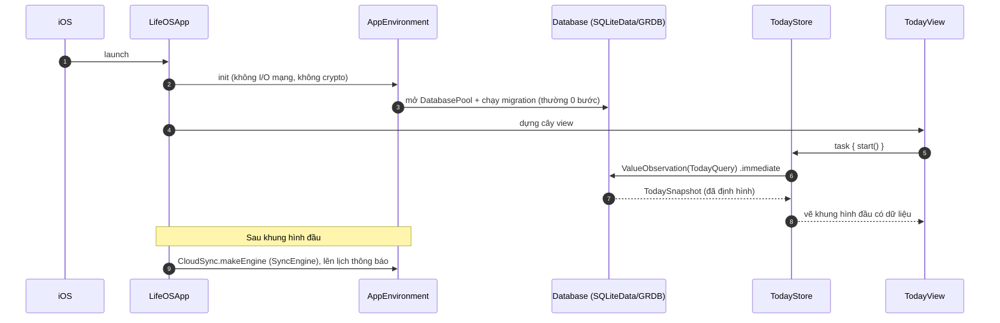
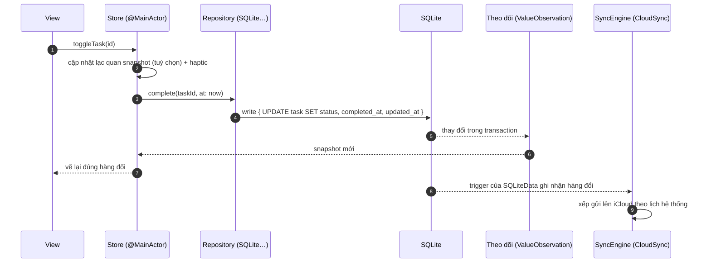
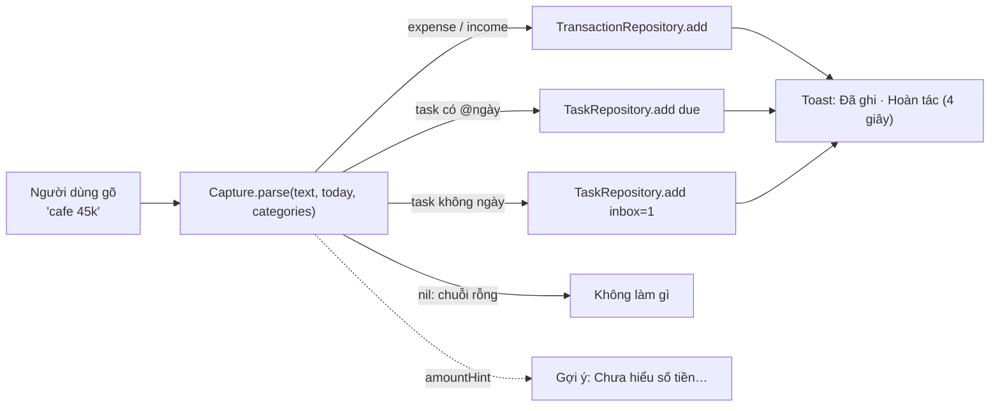
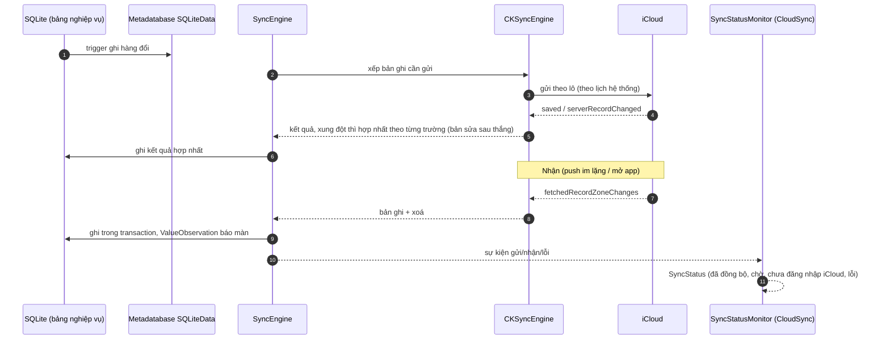
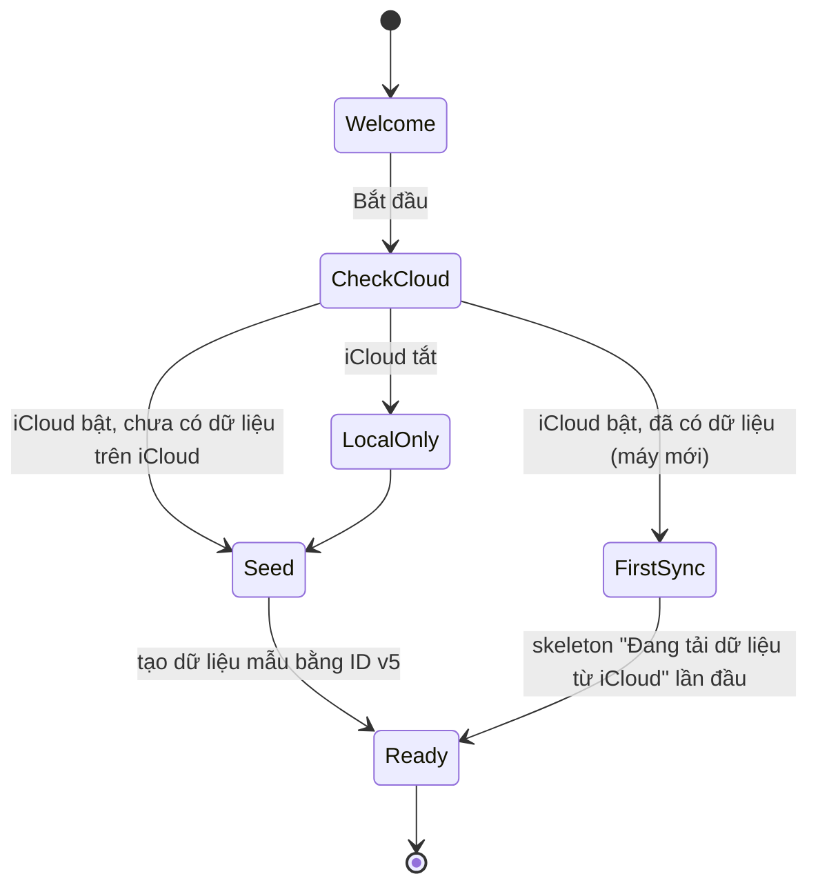
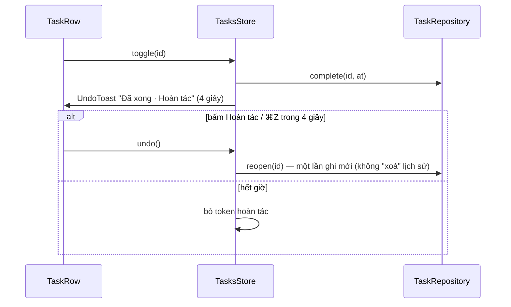
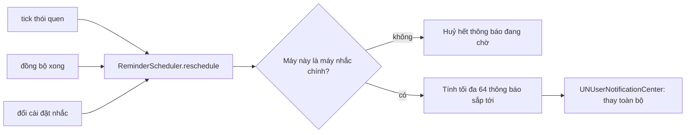

# System design

Tài liệu này mô tả hệ thống bằng sơ đồ (Mermaid, GitHub hiển thị trực tiếp). Mỗi luồng có: sơ đồ, quy tắc thread/actor, điểm lỗi, và test case kiểm nó. **Code một luồng = đi đúng các bước trong sơ đồ, đúng tên thành phần.** Đổi luồng thì sửa sơ đồ trong cùng PR.

## 1. Bối cảnh (C4 mức 1)

> MVP theo ADR-0016: đồng bộ bằng SyncEngine của SQLiteData. Bản có mã hoá đầu-cuối tự làm nằm ở [system-design-post-mvp.md](system-design-post-mvp.md).

Không có máy chủ Life OS. Trong MVP, iCloud lưu dữ liệu dưới dạng bản ghi CloudKit với bảo vệ chuẩn của iCloud. Dữ liệu chỉ được mã hoá đầu-cuối khi người dùng bật Advanced Data Protection (BR-ONB-10).

## 2. Container và lớp (C4 mức 2)

Quy tắc mũi tên (bị kiểm bằng build + `scripts/check-core-imports.sh`):
- `LifeOSCore` không import `SwiftUI`, `UIKit`, `AppKit`, `CloudKit`, `CryptoKit`, `Security`, `os`, `Combine`, `WidgetKit`, `GRDB`, `SQLiteData`. Chỉ dùng `Foundation` (bản swift-corelibs).
- Feature không import feature khác. Feature không import `LifeOSPlatform`, `CloudSync`, `SQLiteData`; chỉ thấy protocol repository và snapshot trong `Persistence`.
- `SyncEngine` chỉ xuất hiện trong `CloudSync` và `AppFeature` (TC-SYNC-14).
- Chỉ `AppFeature` biết cài đặt cụ thể (ghép DI).
- `SyncCore`, `CryptoCore`, `CryptoApple`, `CloudKitTransport` vẫn nằm trong repo nhưng chưa được nối vào app (sau MVP, LOS-075).

## 3. Mô hình chạy (thread & actor)

| Thành phần | Chạy ở đâu | Ghi chú |
|---|---|---|
| View, Store | `@MainActor` | Store chỉ giữ snapshot giá trị; không I/O |
| Repository | `DatabasePool` của GRDB qua SQLiteData (hàng đợi riêng) | `async` API; ghi luôn trong `write { }` |
| `ValueObservation` | Đọc trên pool, giao kết quả `.immediate` lần đầu rồi về main | Lần đầu đồng bộ để không nháy "đang tải" |
| `SyncEngine` (SQLiteData) | Do thư viện quản lý, ngoài main | Ta chỉ đọc trạng thái qua `SyncStatusMonitor` |
| Định dạng số/ngày | `FormatterCache` tạo một lần | Không tạo formatter trong `body` |

## 4. Luồng: khởi động lạnh tới màn Hôm nay (mục tiêu ≤ 400 ms)

Điểm lỗi: migration lỗi → màn "File dữ liệu trong máy hỏng" (BR-GEN-05), không crash. Kiểm: TC-PERF-01, TC-GEN-03.

## 5. Luồng: ghi một thay đổi (mọi tính năng)

Bất biến: **một thao tác người dùng = một transaction**. Repository không biết đồng bộ; SyncEngine tự thấy thay đổi qua trigger. Không có đường ghi nào bỏ qua repository cho bảng nghiệp vụ. Kiểm: TC-GEN-01, TC-SYNC-14.

## 6. Luồng: Ghi nhanh

Bộ hiểu là hàm thuần trong `Capture` (SPEC-quick-capture), có test vector. Xem trước kết quả cập nhật theo từng phím gõ, nên phải < 1 ms với chuỗi 200 ký tự. Kiểm: TC-CAP-*.

## 7. Luồng: đồng bộ (gửi và nhận)

Mọi chi tiết gửi, nhận và hợp nhất do SQLiteData lo. Phần ta tự làm chỉ có: danh sách bảng (`SyncTables`), `SyncStatusMonitor` cho badge (BR-SYNC-01), và gọi sync khi mở app. LOS-030 đo hành vi thật: lệch giờ, cột lạ từ phiên bản mới hơn, giết app giữa lô. Kiểm: TC-SYNC-05..08, 12, 13, 15.

## 8. Luồng: lần đầu dùng và máy mới

MVP không có khoá chủ hay mã khôi phục. Dữ liệu mẫu dùng ID v5, nên hai máy cùng tạo kho sẽ ghi vào cùng bản ghi, không sinh hai bộ danh mục. Màn Chào mừng nói đúng mức bảo vệ (BR-ONB-10). Kiểm: TC-ONB-03, 05, 07.

## 9. Luồng: tick việc và hoàn tác

Hoàn tác là một thay đổi mới, không phải rollback, để hội tụ đúng khi máy khác đã nhận thay đổi trước. Kiểm: TC-TSK-04.

## 10. Luồng: nhắc nhở cục bộ (sau MVP)

## 11. Ánh xạ luồng → code

| Luồng | Thành phần chính | Target |
|---|---|---|
| Khởi động | `LifeOSApp`, `prepareDependencies`, `AppEnvironment.live()`, `AppDatabase`, `TodayStore` | App, AppFeature, Persistence, TodayFeature |
| Ghi thay đổi | `SQLite*Repository` | Persistence |
| Ghi nhanh | `QuickCaptureParser`, `CaptureStore` | Capture, CaptureFeature |
| Đồng bộ | `CloudSync.makeEngine`, `SyncTables`, `SyncStatusMonitor` | CloudSync |
| Khoá (sau MVP) | `KeyVault`, `RecoveryCode`, `EnvelopeCodec`, `CryptoKitProvider`, `KeychainStore` | CryptoCore, CryptoApple |
| Hoàn tác | `UndoCoordinator` (FeatureSupport), `UndoToast` | FeatureSupport, DesignSystem |
