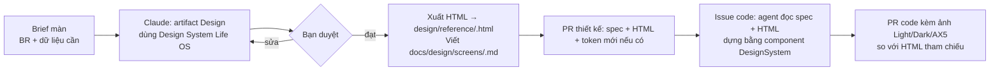

# Quy trình thiết kế: lưu ở đâu, làm bằng gì, lấy ra code thế nào

## 1. Ba lớp, mỗi lớp một nơi

| Lớp | Nơi lưu | Định dạng | Vì sao |
|---|---|---|---|
| **Token** (màu, chữ, khoảng cách, chuyển động) | `design/tokens/tokens.json` | JSON | Một nguồn, sinh ra Swift/CSS/Compose; CI kiểm lệch |
| **Component** | `Packages/LifeOSDesignSystem` | Swift | Code thật là thiết kế thật; Catalog preview là "thư viện" |
| **Màn và luồng** | `docs/design/screens/<man>.md` + `design/reference/*.html` | Markdown spec + HTML tham chiếu | Agent đọc spec chữ chính xác hơn đọc ảnh; HTML để nhìn |

Artifact trên claude.ai (Library, Screens, các bản Design mới) là **nơi khám phá và duyệt**. Khi đã duyệt, kết quả đi vào repo; từ đó repo là nguồn sự thật.

## 2. Dùng công cụ nào (đề xuất của tôi)

Claude Design bản riêng (claude.ai/design) **đóng ngày 14/12/2026**; tính năng thiết kế nay nằm ngay trong Claude dưới dạng artifact loại **Design** (canvas nhiều artboard) và **Design System** (README + token + component có preview, agent đọc được). Vì vậy:

| Lựa chọn | Hợp cho | Điểm yếu | Gợi ý |
|---|---|---|---|
| **Artifact "Design System" trong Claude** dựng từ `tokens.json` + component | Một nơi để mọi bản Design mới tự dùng đúng màu/chữ; xem nhanh trên web | Là bản sao: phải cập nhật khi token đổi | **Dùng**, làm hệ mặc định (issue LOS-005) |
| **Artifact "Design"** trong Claude | Vẽ màn mới (GĐ2: Mục tiêu, Dự án…), so phương án, bình luận | HTML, không phải SwiftUI | **Dùng** cho màn mới |
| Artifact HTML tự viết (như Library/Screens hiện tại) | Đã có, đủ chi tiết | Khó sửa từng phần | Giữ làm tham chiếu MVP, không làm mới theo cách này |
| claude.ai/design (bản riêng) | — | Đóng 14/12/2026 | **Không dùng** |
| Figma | Designer chuyên nghiệp | Thêm công cụ, thêm bước đồng bộ | Chỉ nếu có designer |
| Chỉ SwiftUI Preview | Tinh chỉnh cuối | Khám phá phương án chậm | Dùng ở bước code |

## 3. Luồng làm một màn mới

Quy tắc:
1. Không có spec màn trong `docs/design/screens/` thì không code màn đó.
2. Màn mới chỉ dùng token và component có sẵn; cần component mới thì thêm vào DesignSystem trước (PR riêng, có Catalog preview).
3. Đổi token = sửa `tokens.json` → `generate.py` → commit file sinh ra → cập nhật artifact Design System (một lần mỗi PR token).
4. Code SwiftUI **không dịch từ HTML**. HTML là ảnh tham chiếu bố cục và trạng thái; hành vi lấy từ spec.

## 4. Agent lấy design khi code thế nào
Trong issue có mục "Design": đường dẫn spec màn + tên frame trong `design/reference/screens.html` (ví dụ "Hôm nay · iPhone · Tối 20:15"). Agent:
1. Đọc `docs/design/screens/<man>.md` (bố cục, trạng thái, câu chữ, dữ liệu, tương tác, trợ năng).
2. Mở `design/reference/screens.html` trong trình duyệt (hoặc chụp bằng Playwright) để nhìn frame.
3. Dùng `Packages/LifeOSDesignSystem` (README có bảng ánh xạ 38 component), không tự đặt màu/khoảng cách.
4. Gắn ảnh preview vào PR.
