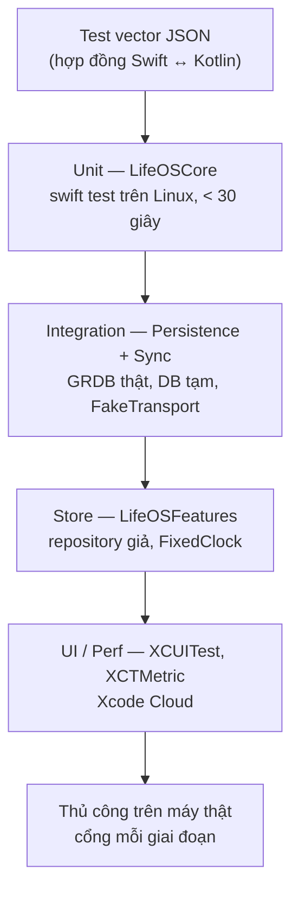

# Chiến lược kiểm thử

| Tầng | Ở đâu | Chạy khi | Ghi chú |
|---|---|---|---|
| Vector | `Tests/*/VectorTests.swift` đọc `TestVectors/` qua `VectorLoader` | Mỗi PR (Linux) | Không sửa vector để test xanh: vector đổi = spec đổi |
| Unit | `Packages/LifeOSCore/Tests` | Mỗi PR (Linux) | Hàm thuần, không I/O |
| Integration | `PersistenceTests`, `SyncCoreTests/Harness` | Mỗi PR (Linux) | DB `:memory:` hoặc file tạm; harness 10.000 vòng |
| Store | `LifeOSFeatures/Tests` | Mỗi PR (Xcode Cloud / máy dev) | Không simulator nếu được (`swift test` trên macOS) |
| UI/Perf | `App/LifeOSUITests`, `LifeOSPerfTests` | PR nhãn `perf` + hằng đêm | DB seed 3 năm |
| Thủ công | `docs/test-cases/*` mức M | Cổng giai đoạn, trước TestFlight | Ghi kết quả vào issue cổng |

Quy tắc:
1. Tính năng mới = test case mới (TC-xxx) trong cùng PR, ánh xạ tới BR.
2. Sửa bug = test tái hiện đỏ trước, rồi sửa.
3. Không `sleep` trong test; dùng `FixedClock` và `AsyncStream` có kiểm soát.
4. Không bao giờ bỏ qua/tắt test để xanh CI.
5. Dữ liệu test: `Fixtures.demo` (Thứ Sáu 30/10/2026, người dùng An) giống design để so ảnh.
