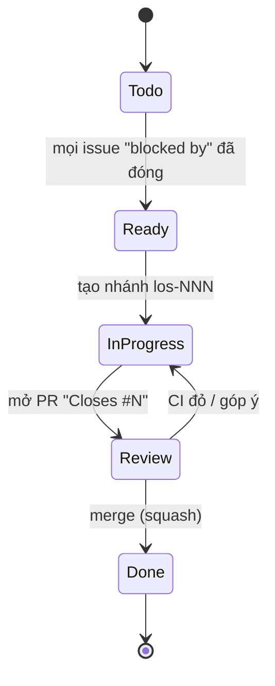

# Quy trình làm việc: thư mục Mac ↔ GitHub ↔ issue ↔ PR

## 1. Thiết lập lần đầu (một lần)
1. Giải nén / chép thư mục `life-os` vào nơi bạn code, ví dụ `~/Developer/life-os` (tránh để trong iCloud Drive/Downloads: iCloud Drive đồng bộ `.build` và `DerivedData` rất chậm).
2. Tạo repo **private** trống trên GitHub (không README, không .gitignore), ví dụ `duong6003/life-os`.
3. Trong Terminal:
   ```sh
   cd ~/Developer/life-os
   git init -b main && git add . && git commit -m "chore: bootstrap spec kit (LOS-001)"
   git remote add origin git@github.com:<user>/life-os.git && git push -u origin main
   gh auth login                     # nếu chưa
   python3 scripts/bootstrap_github.py --repo <user>/life-os            # xem trước (dry-run)
   python3 scripts/bootstrap_github.py --repo <user>/life-os --apply    # tạo label, milestone, issue, quan hệ phụ thuộc
   ```
4. Bật branch protection cho `main`: cần PR, cần check `checks` và `core-swift` xanh.

## 2. Nhánh và commit
- Trunk-based: `main` luôn build được. Nhánh ngắn: `los-<số>-<slug>` (vd. `los-012-hlc`).
- Commit theo Conventional Commits, tiếng Anh, có mã issue:
  `feat(sync): add HLC tick/receive (LOS-012)` · `fix(capture): …` · `docs(spec): …` · `test: …` · `chore: …` · `perf: …`
- Một PR = một issue (hoặc một phần rõ ràng của issue). PR > 600 dòng thay đổi (không tính file sinh/vector) → tách.

## 3. Vòng đời một issue

Định nghĩa **Ready**: có tiêu chí nghiệm thu, đã chỉ rõ BR/TC/SPEC liên quan, các phụ thuộc đã xong.
Định nghĩa **Done**: tiêu chí nghiệm thu đạt; test mới xanh; tài liệu (spec/ADR/BR/TC/sơ đồ) cập nhật trong cùng PR; không cảnh báo build mới; với UI: ảnh Light/Dark trong PR.

## 4. Nhãn
| Nhóm | Nhãn |
|---|---|
| Loại | `type:feature` `type:spike` `type:chore` `type:bug` `type:docs` `type:gate` |
| Vùng | `area:core` `area:sync` `area:crypto` `area:persistence` `area:capture` `area:ui` `area:design` `area:ci` |
| Module | `mod:today` `mod:tasks` `mod:habits` `mod:journal` `mod:spending` `mod:review` `mod:onboarding` `mod:settings` |
| Khác | `perf` (chạy test hiệu năng), `agent-ok` (giao được cho agent), `needs-decision` |

## 5. Milestone = giai đoạn
`M0 Nền móng` · `M1 Lõi dữ liệu cục bộ` · `M2 MVP cục bộ` · `M3 Bắt đầu` · `M4 Đồng bộ iCloud` · `M5 Hoàn thiện và beta` · `M6 Sau MVP`. Mỗi milestone kết thúc bằng một issue `type:gate` có số đo.

## 6. Làm việc với Claude Code trên Mac
- Mở Terminal tại thư mục repo, chạy `claude`. Agent đọc `CLAUDE.md` tự động.
- Giao việc theo issue: `/implement-issue 12` (lệnh trong `.claude/commands/`). Agent tạo nhánh, code, chạy test, mở PR "Closes #12".
- Bạn review PR trên GitHub; agent sửa theo góp ý.
- Đồng bộ: `git pull` trước khi bắt đầu, push nhánh khi xong. Không commit thẳng `main`.

## 7. Phát hành
- Phiên bản `MAJOR.MINOR.PATCH` (marketing) + build number tăng tự động trong Xcode Cloud.
- TestFlight từ M5. Changelog = tiêu đề PR đã merge giữa hai tag `v*`.
- Mỗi bản phát hành ghi số đo TC-PERF-01/07/08 vào `perf-log.md`.
