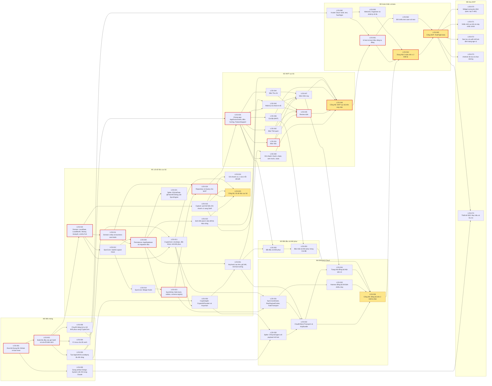

# Plan dạng graph

Nguồn: mỗi file trong [`issues/`](issues) là một issue (frontmatter: milestone, nhãn, `depends_on`). Graph dưới đây **sinh tự động** bằng `python3 scripts/plan_graph.py`; CI kiểm nó không cũ và không có vòng phụ thuộc. Đổi plan = sửa file issue, chạy script, commit cả hai.

Lên GitHub: `scripts/bootstrap_github.py` tạo milestone, nhãn, issue và quan hệ **blocked by** từ cùng các file này.

Cách đọc: mũi tên A → B nghĩa là B cần A xong trước. Ô vàng là **cổng** (gate) có số đo. Viền đỏ là đường găng (chuỗi dài nhất, quyết định tiến độ). Song song được: các màn M2 với nhau, và luồng Bắt đầu (M3) sau khi KeyVault xong; spike CloudKit (LOS-030) chạy được ngay khi có Xcode project và CryptoApple.

<!-- graph:begin -->

| Milestone | Số issue | Issue |
|---|---|---|
| M0 Nền móng | 6 | LOS-001, LOS-002, LOS-003, LOS-004, LOS-005, LOS-006 |
| M1 Lõi dữ liệu cục bộ | 15 | LOS-010, LOS-011, LOS-012, LOS-013, LOS-014, LOS-015, LOS-016, LOS-020, LOS-021, LOS-022, LOS-023, LOS-024, LOS-025, LOS-050, LOS-051 |
| M2 MVP cục bộ | 10 | LOS-035, LOS-040, LOS-041, LOS-042, LOS-043, LOS-044, LOS-045, LOS-046, LOS-047, LOS-048 |
| M3 Bắt đầu và khôi phục | 2 | LOS-052, LOS-053 |
| M4 Đồng bộ iCloud | 6 | LOS-030, LOS-031, LOS-032, LOS-033, LOS-034, LOS-036 |
| M5 Hoàn thiện và beta | 6 | LOS-060, LOS-061, LOS-062, LOS-063, LOS-064, LOS-065 |
| M6 Sau MVP | 5 | LOS-070, LOS-071, LOS-072, LOS-073, LOS-074 |

**Đường găng** (viền đỏ, ước lượng S=1, M=2, L=3): LOS-001 → LOS-002 → LOS-010 → LOS-011 → LOS-020 → LOS-023 → LOS-024 → LOS-035 → LOS-041 → LOS-045 → LOS-048 → LOS-061 → LOS-064 → LOS-065
<!-- graph:end -->

## Thứ tự gợi ý cho một người + agent
1. Tuần 1: LOS-001 → 002 → 003, 004, 006 (song song: 005 thiết kế).
2. Tuần 2–3: 010 → 011, 012, 013, 015 → 014 → 020 → 023 → 024, 022 → cổng 025.
3. Tuần 3–4 (song song với lõi): 050 → 051 (CryptoKit, KeyVault).
4. Tuần 4–7: 035 → 040–047 (agent làm song song từng màn); 052 → 053; cổng 048.
5. Tuần 6–9: spike 030 sớm nhất có thể; 031 → 033, 032 → 034; cổng 036.
6. Tuần 10–12: 060 → 061 → 062, 063 → dùng thật 064 → beta 065.

Ước lượng tuần là giả định cho một người làm toàn thời gian có agent hỗ trợ; chưa có số liệu thật.
