# Plan dạng graph

Nguồn: mỗi file trong [`issues/`](issues) là một issue (frontmatter: milestone, nhãn, `depends_on`). Graph dưới đây **sinh tự động** bằng `python3 scripts/plan_graph.py`; CI kiểm nó không cũ và không có vòng phụ thuộc. Đổi plan = sửa file issue, chạy script, commit cả hai.

Lên GitHub: `scripts/bootstrap_github.py` tạo milestone, nhãn, issue và quan hệ **blocked by** từ cùng các file này.

Cách đọc: mũi tên A → B nghĩa là B cần A xong trước. Ô vàng là **cổng** (gate) có số đo. Viền đỏ là đường găng (chuỗi dài nhất, quyết định tiến độ). Song song được: các màn M2 với nhau; spike SyncEngine (LOS-030) chạy được ngay khi có Xcode project và spike SQLiteData (LOS-021). Nhánh đồng bộ mã hoá tự làm (M6, kết thúc ở LOS-075) chỉ bắt đầu sau cổng MVP (ADR-0016).

```mermaid
flowchart LR
  subgraph M0["M0 Nền móng"]
    LOS001["LOS-001<br/>Đưa bộ khung lên GitHub và tạo issue"]
    LOS002["LOS-002<br/>Build lần đầu các gói Swift và sửa lỗi biên dịch"]
    LOS003["LOS-003<br/>Tạo App/LifeOS.xcodeproj đa nền tảng"]
    LOS004["LOS-004<br/>CI Linux cho lõi xanh"]
    LOS005["LOS-005<br/>Dựng artifact Design System Life OS trong Claude"]
  end
  subgraph M1["M1 Lõi dữ liệu cục bộ"]
    LOS010["LOS-010<br/>Domain: LocalDate, LocalMonth, Money, EntityID, UUIDv7/v5"]
    LOS011["LOS-011<br/>Domain: entity và business rule thuần"]
    LOS015["LOS-015<br/>Capture: port bộ hiểu Ghi nhanh v1 sang Swift"]
    LOS016["LOS-016<br/>Ghi nhanh v1.1: sửa 4 lỗi đã biết"]
    LOS020["LOS-020<br/>Persistence: AppDatabase trên SQLiteData và migration đầu"]
    LOS021["LOS-021<br/>Spike: xác minh SQLiteData cho Life OS"]
    LOS022["LOS-022<br/>Sinh DB seed 3 năm để đo hiệu năng"]
    LOS024["LOS-024<br/>Repository và Query cho MVP"]
    LOS025["LOS-025<br/>Cổng M1: lõi dữ liệu cục bộ"]
  end
  subgraph M2["M2 MVP cục bộ"]
    LOS035["LOS-035<br/>Khung app: AppEnvironment, điều hướng, FeatureSupport"]
    LOS040["LOS-040<br/>Ghi nhanh: thanh, sheet, xem trước, toast"]
    LOS041["LOS-041<br/>Màn Việc"]
    LOS042["LOS-042<br/>Màn Thói quen"]
    LOS043["LOS-043<br/>Nhật ký và check-in tối"]
    LOS044["LOS-044<br/>Màn Thu chi"]
    LOS045["LOS-045<br/>Review tuần"]
    LOS046["LOS-046<br/>Cài đặt (MVP)"]
    LOS047["LOS-047<br/>Màn Hôm nay"]
    LOS048["LOS-048<br/>Cổng M2: MVP cục bộ trên máy thật"]
  end
  subgraph M3["M3 Bắt đầu"]
    LOS052["LOS-052<br/>Bắt đầu: chào mừng, iCloud, máy mới"]
  end
  subgraph M4["M4 Đồng bộ iCloud"]
    LOS026["LOS-026<br/>CloudSync: bật SyncEngine cho mọi bảng MVP"]
    LOS030["LOS-030<br/>Spike: SyncEngine trên 2 thiết bị thật"]
    LOS034["LOS-034<br/>Trạng thái đồng bộ thật trên UI"]
    LOS036["LOS-036<br/>Cổng M4: đồng bộ trên 2 thiết bị thật"]
  end
  subgraph M5["M5 Hoàn thiện và beta"]
    LOS060["LOS-060<br/>Xcode Cloud: build, test, TestFlight"]
    LOS061["LOS-061<br/>UI test và test hiệu năng tự động"]
    LOS062["LOS-062<br/>Đối chiếu test case với test"]
    LOS063["LOS-063<br/>MetricKit, Organizer và nhật ký số đo"]
    LOS064["LOS-064<br/>Dùng thật 2 tuần trên ≥ 2 thiết bị"]
    LOS065["LOS-065<br/>Cổng MVP: TestFlight beta"]
  end
  subgraph M6["M6 Sau MVP"]
    LOS006["LOS-006<br/>Chuyển bảng ký tự mã khôi phục sang CryptoCore"]
    LOS012["LOS-012<br/>SyncCore: Hybrid Logical Clock"]
    LOS013["LOS-013<br/>CryptoCore: envelope, dẫn khoá, mã khôi phục"]
    LOS014["LOS-014<br/>SyncCore: Merger thuần"]
    LOS023["LOS-023<br/>SyncWriter, field clock, outbox, schema registry"]
    LOS031["LOS-031<br/>SyncCoordinator, RowPayloadCodec, FakeTransport"]
    LOS032["LOS-032<br/>CloudKitSyncTransport và KeyBundle"]
    LOS033["LOS-033<br/>Harness đồng bộ tất định nhiều máy"]
    LOS050["LOS-050<br/>CryptoApple: CryptoKitProvider và Keychain"]
    LOS051["LOS-051<br/>KeyVault: tạo kho, giữ MK, mã hoá trường"]
    LOS053["LOS-053<br/>Mã khôi phục trong Cài đặt"]
    LOS070["LOS-070<br/>Widget tương tác (thói quen, top 3 việc)"]
    LOS071["LOS-071<br/>Nhắc nhở cục bộ và máy nhắc chính"]
    LOS072["LOS-072<br/>Sao lưu và xuất mã hoá định dạng age v1"]
    LOS073["LOS-073<br/>Android: đo lại và chọn đường"]
    LOS074["LOS-074<br/>Thiết kế GĐ2: Mục tiêu và Dự án"]
    LOS075["LOS-075<br/>Đồng bộ mã hoá đầu-cuối: thay CloudSync bằng lớp tự làm"]
  end
  LOS001 --> LOS002
  LOS002 --> LOS003
  LOS002 --> LOS004
  LOS001 --> LOS005
  LOS065 --> LOS006
  LOS002 --> LOS010
  LOS010 --> LOS011
  LOS065 --> LOS012
  LOS010 --> LOS013
  LOS006 --> LOS013
  LOS012 --> LOS014
  LOS010 --> LOS015
  LOS015 --> LOS016
  LOS011 --> LOS020
  LOS021 --> LOS020
  LOS002 --> LOS021
  LOS020 --> LOS022
  LOS020 --> LOS023
  LOS014 --> LOS023
  LOS020 --> LOS024
  LOS011 --> LOS024
  LOS022 --> LOS025
  LOS024 --> LOS025
  LOS015 --> LOS025
  LOS030 --> LOS026
  LOS024 --> LOS026
  LOS003 --> LOS030
  LOS021 --> LOS030
  LOS023 --> LOS031
  LOS013 --> LOS031
  LOS031 --> LOS032
  LOS051 --> LOS032
  LOS031 --> LOS033
  LOS026 --> LOS034
  LOS047 --> LOS034
  LOS003 --> LOS035
  LOS024 --> LOS035
  LOS026 --> LOS036
  LOS034 --> LOS036
  LOS052 --> LOS036
  LOS035 --> LOS040
  LOS015 --> LOS040
  LOS035 --> LOS041
  LOS035 --> LOS042
  LOS035 --> LOS043
  LOS035 --> LOS044
  LOS041 --> LOS045
  LOS042 --> LOS045
  LOS043 --> LOS045
  LOS044 --> LOS045
  LOS035 --> LOS046
  LOS041 --> LOS047
  LOS042 --> LOS047
  LOS043 --> LOS047
  LOS044 --> LOS047
  LOS040 --> LOS048
  LOS045 --> LOS048
  LOS046 --> LOS048
  LOS047 --> LOS048
  LOS022 --> LOS048
  LOS013 --> LOS050
  LOS003 --> LOS050
  LOS050 --> LOS051
  LOS035 --> LOS052
  LOS051 --> LOS053
  LOS046 --> LOS053
  LOS003 --> LOS060
  LOS048 --> LOS061
  LOS060 --> LOS061
  LOS061 --> LOS062
  LOS060 --> LOS063
  LOS036 --> LOS064
  LOS061 --> LOS064
  LOS063 --> LOS064
  LOS064 --> LOS065
  LOS062 --> LOS065
  LOS065 --> LOS070
  LOS065 --> LOS071
  LOS065 --> LOS072
  LOS065 --> LOS073
  LOS005 --> LOS074
  LOS065 --> LOS074
  LOS032 --> LOS075
  LOS033 --> LOS075
  LOS053 --> LOS075
  class LOS025 gate
  class LOS036 gate
  class LOS048 gate
  class LOS064 gate
  class LOS065 gate
  class LOS001,LOS002,LOS010,LOS011,LOS020,LOS024,LOS035,LOS041,LOS045,LOS048,LOS061,LOS064,LOS065 crit
  classDef gate fill:#fde68a,stroke:#b45309
  classDef crit stroke:#dc2626,stroke-width:3px
```

<!-- graph:begin -->

| Milestone | Số issue | Issue |
|---|---|---|
| M0 Nền móng | 5 | LOS-001, LOS-002, LOS-003, LOS-004, LOS-005 |
| M1 Lõi dữ liệu cục bộ | 9 | LOS-010, LOS-011, LOS-015, LOS-016, LOS-020, LOS-021, LOS-022, LOS-024, LOS-025 |
| M2 MVP cục bộ | 10 | LOS-035, LOS-040, LOS-041, LOS-042, LOS-043, LOS-044, LOS-045, LOS-046, LOS-047, LOS-048 |
| M3 Bắt đầu | 1 | LOS-052 |
| M4 Đồng bộ iCloud | 4 | LOS-026, LOS-030, LOS-034, LOS-036 |
| M5 Hoàn thiện và beta | 6 | LOS-060, LOS-061, LOS-062, LOS-063, LOS-064, LOS-065 |
| M6 Sau MVP | 17 | LOS-006, LOS-012, LOS-013, LOS-014, LOS-023, LOS-031, LOS-032, LOS-033, LOS-050, LOS-051, LOS-053, LOS-070, LOS-071, LOS-072, LOS-073, LOS-074, LOS-075 |

**Đường găng** (viền đỏ, ước lượng S=1, M=2, L=3): LOS-001 → LOS-002 → LOS-010 → LOS-011 → LOS-020 → LOS-024 → LOS-035 → LOS-041 → LOS-045 → LOS-048 → LOS-061 → LOS-064 → LOS-065
<!-- graph:end -->

## Thứ tự gợi ý cho một người + agent
1. Tuần 1: LOS-001 → 002 → 003, 004 (song song: 005 thiết kế).
2. Tuần 2–3: 010 → 011, 015 → spike 021 (xác minh SQLiteData) → 020 → 024, 022 → cổng 025.
3. Tuần 3–6: 035 → 040–047 (agent làm song song từng màn); 052; cổng 048.
4. Tuần 5–7: spike 030 sớm nhất có thể → 026 → 034; cổng 036.
5. Tuần 8–10: 060 → 061 → 062, 063 → dùng thật 064 → beta 065.
6. Sau MVP: 012 → 014 → 023 → 031 → 033; 006 → 013 → 050 → 051 → 032, 053 → 075 (đồng bộ mã hoá đầu-cuối).

Ước lượng tuần là giả định cho một người làm toàn thời gian có agent hỗ trợ; chưa có số liệu thật.
