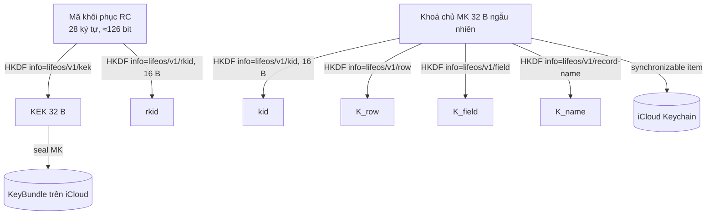

# SPEC-crypto · Life OS Crypto Spec v1

> **Áp dụng sau MVP (ADR-0016, LOS-075).** MVP không có khoá chủ, envelope hay mã khôi phục; dữ liệu iCloud được bảo vệ theo chuẩn iCloud (E2EE khi người dùng bật Advanced Data Protection, BR-ONB-10).

- Version: **1.0-draft** (01/11/2026)
- Kiểm bằng: `TestVectors/envelope/*.json`, `TestVectors/recovery-code/*.json`, `reference/lifeos_ref/crypto.py` (dùng thư viện `cryptography` của Python làm oracle).
- Quyết định nền: ADR-0006. Mối đe doạ: `docs/engineering/threat-model.md`.

## 1. Primitive

| Việc | Thuật toán | Apple | Android (sau) |
|---|---|---|---|
| AEAD | ChaCha20-Poly1305 (RFC 8439), khoá 32 B, nonce 12 B, tag 16 B | `CryptoKit.ChaChaPoly` | JCA `ChaCha20-Poly1305` / Tink |
| Dẫn khoá | HKDF-SHA256 (RFC 5869) | `CryptoKit.HKDF<SHA256>` | JCA/BouncyCastle |
| MAC | HMAC-SHA256 | `CryptoKit.HMAC<SHA256>` | JCA |
| Ngẫu nhiên | CSPRNG hệ thống | `SecRandomCopyBytes` / `SymmetricKey(size:)` | `SecureRandom` |

Không dùng thuật toán nào khác trong v1. Không dùng mật khẩu người dùng làm khoá (không có KDF chậm).

## 2. Cây khoá



HKDF luôn dùng `salt = 32 byte 0x00` trừ khi ghi khác, `info` là UTF-8 của chuỗi ghi trên mũi tên, độ dài ra 32 B (hoặc 16 B cho id).

- `kid` = 16 B đầu HKDF(MK, info "lifeos/v1/kid"), hiển thị hex thường.
- `K_row`: mã hoá RowPayload gửi lên cloud.
- `K_field`: mã hoá trường nhạy cảm **cục bộ** (`journal_entry.body_sealed`).
- `K_name`: HMAC tên bản ghi (SPEC-sync §3.3).

## 3. Mã khôi phục (RC)

- Bảng ký tự: `ACDEFGHJKMNPQRTWXY34679` (23 ký tự; bỏ O I L S B Z U V 0 1 2 5 8).
- Độ dài 28 ký tự → log2(23)×28 ≈ 126,6 bit.
- Sinh: lấy byte ngẫu nhiên `b`; nếu `b < 230` thì ký tự `alphabet[b % 23]`, ngược lại bỏ (rejection sampling, không lệch phân phối).
- Hiển thị: 7 nhóm 4 ký tự cách nhau dấu cách: `K7QP 3MXR 9RTA WC4H NE6D F4DW YE7K`.
- Chuẩn hoá khi nhập: viết hoa, bỏ mọi ký tự không phải chữ/số. Sau chuẩn hoá: ký tự ngoài bảng → báo ngay "có ký tự đọc nhầm" (không cần thử giải mã); độ dài ≠ 28 → chưa đủ.
- `KEK = HKDF(ikm = UTF8(RC chuẩn hoá), salt = UTF8("lifeos/v1/recovery"), info = "lifeos/v1/kek")`.
- `rkid = HKDF(ikm như trên, salt như trên, info = "lifeos/v1/rkid", 16 B)`.

## 4. Envelope LOS1

```
offset  độ dài  trường
0       3       magic  = "LOS" (0x4C 0x4F 0x53)
3       1       version = 0x01
4       16      kid    (kid của khoá dùng để mã hoá: kid của MK, hoặc rkid với KeyBundle)
20      12      nonce  (ngẫu nhiên mỗi lần)
32      n       ciphertext
32+n    16      tag
```
AAD = UTF-8 của `"lifeos/v1|" + context` nối với 4 byte đầu header (magic+version) và `kid` — tức là header 20 byte cũng được xác thực:
`AAD = header[0:20] || UTF8("lifeos/v1|" + context)`.

| Dùng cho | Khoá | `context` |
|---|---|---|
| RowPayload lên cloud | `K_row` | `row|<recordName>` |
| Trường nhật ký cục bộ | `K_field` | `field|journal_entry|<id>|body` |
| Bản nhật ký xung đột | `K_field` | `field|journal_conflict|<id>|body` |
| KeyBundle | `KEK` | `mkwrap|<hex kid của MK>` |

Giải mã: kiểm magic/version (khác → `UnsupportedVersion`), tìm khoá theo `kid` (không có → `UnknownKey` → trạng thái `needsRecoveryKey`), mở AEAD (sai → `Tampered`). Không bao giờ trả về bản rõ một phần.

Nonce ngẫu nhiên 96 bit: giới hạn an toàn ~2^32 lần mã hoá cho một khoá — dư cho dữ liệu cá nhân; xoay khoá (v2) trước khi chạm 2^28.

## 5. Mã hoá cục bộ
- File DB: Data Protection `completeUntilFirstUserAuthentication` (class C) để widget và đồng bộ nền mở được.
- `journal_entry.body_sealed`, `journal_conflict.body_sealed` = envelope bằng `K_field`. Giải mã khi mở bài, không giải mã cả danh sách.
- MK giữ trong Keychain (`kSecAttrAccessibleAfterFirstUnlock`, `kSecAttrSynchronizable = true`, service `life.os.mk`, account = hex kid). Không ghi MK ra file, log, hay UserDefaults.

## 6. Vòng đời kho khoá

### 6.1 KeyBundle (trên cloud)
CKRecord `KeyBundle/keybundle`: `wrapped` (Bytes, envelope LOS1 với KEK chứa 32 B MK), `mkid` (String hex kid), `rkid` (String hex), `pv` = 1.

### 6.2 Các trường hợp khi mở app

| Keychain có MK | KeyBundle trên cloud | Hành động |
|---|---|---|
| Có | Có, `mkid` khớp | Sẵn sàng |
| Có | Không có / iCloud tắt | Sẵn sàng; tải KeyBundle lên khi có iCloud |
| Không | Có | Hỏi mã khôi phục → mở KeyBundle → lưu MK vào Keychain |
| Không | Không | Tạo kho mới: sinh MK + RC, hiện RC, kiểm tra một nhóm, lưu MK, tải KeyBundle lên |
| Có | Có, `mkid` **khác** | Xung đột kho (§6.3) |

### 6.3 Chặn "hai khoá chủ"
Tải KeyBundle lên dùng chính sách "chỉ lưu nếu chưa có" (CKRecord save với `savePolicy = .ifServerRecordUnchanged` trên bản ghi mới; lỗi `serverRecordChanged` nghĩa là đã có). Máy thua:
1. Không tải gì đã mã hoá bằng MK của mình lên (thứ tự bắt buộc: KeyBundle thành công **trước** khi gửi hàng đầu tiên).
2. Hỏi mã khôi phục của kho đã có (hiện "Life OS trên thiết bị khác đã có dữ liệu").
3. Mở được → giải mã lại `body_sealed` cục bộ bằng `K_field` mới, đưa mọi hàng cục bộ vào outbox, xoá MK cũ.

Một thiết bị **KHÔNG ĐƯỢC** tự sinh MK mới khi đã thấy dữ liệu mang `kid` lạ.

### 6.4 Đổi mã khôi phục (Cài đặt)
Sinh RC mới → bọc lại MK → thay KeyBundle (ghi đè có kiểm `recordChangeTag`). MK không đổi nên dữ liệu không phải mã hoá lại.

### 6.5 Xoay khoá chủ (v2, ngoài MVP)
MK mới có `kid` mới; bản ghi cũ vẫn mở bằng MK cũ giữ trong Keychain cho tới khi mã hoá lại hết.

## 7. File xuất / sao lưu (sau MVP)
Định dạng **age v1** (C2SP), recipient X25519 hoặc scrypt-less "passphrase" không dùng; kiểm bằng age testkit. Spec chi tiết ở SPEC-crypto 1.1.
